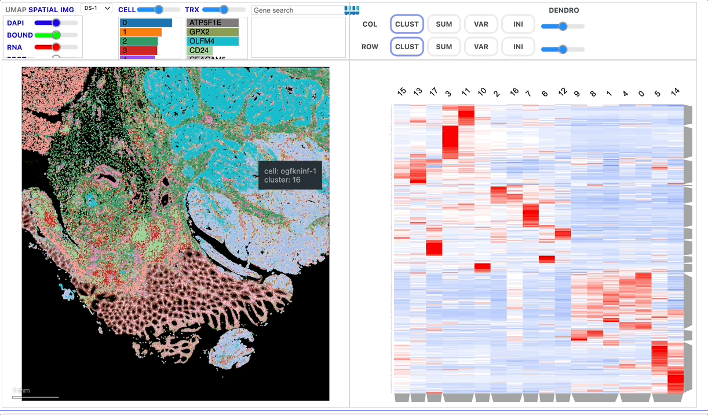

[](https://pypi.org/project/celldega/)
[](https://www.python.org/downloads/)
[](https://broadinstitute.github.io/celldega/)
[](https://molab.marimo.io/notebooks/nb_QLzYVa6S9nBApCwvw9vzni)

# Celldega

Celldega is a toolkit for exploring spatial and single-cell data through linked,
GPU-accelerated visualizations. Explore tissue images, cells, transcripts, and
neighborhoods with **Landscape**; compare expression patterns with **Clustergram**
heatmaps and dot plots; and interpret gene sets with **Enrich**. Other views
include cell portraits, composition charts, and 3D cell and neighborhood clouds.

Use Celldega in Jupyter or marimo notebooks, or as a standalone JavaScript
library. Try it instantly in [molab](https://molab.marimo.io/notebooks/nb_QLzYVa6S9nBApCwvw9vzni),
marimo's cloud notebooks, with a prepared Atera dataset. For
desktop viewing of prepared data, try
[Celldega-App](https://broadinstitute.github.io/celldega/getting-started/desktop-app/).
[Download the latest desktop build](https://github.com/broadinstitute/celldega-app/releases/latest).

[Getting started](https://broadinstitute.github.io/celldega/getting-started/)
· [Visualizations](https://broadinstitute.github.io/celldega/visualizations/)
· [Interactive gallery](https://broadinstitute.github.io/celldega/gallery/)
· [Tutorial notebooks](https://broadinstitute.github.io/celldega/examples/)
· [Changelog](CHANGELOG.md)



## Quick start

Celldega supports Python 3.11 and 3.12. Install it in your notebook's environment:

```bash
pip install celldega
```

Run this in a notebook to explore a prepared Xenium human skin dataset:

```python
import celldega as dega

base_url = (
    "https://raw.githubusercontent.com/broadinstitute/"
    "celldega_Xenium_Prime_Human_Skin_FFPE_outs/main/"
    "Xenium_Prime_Human_Skin_FFPE_outs"
)

landscape = dega.viz.Landscape(
    base_url=base_url,
    ini_zoom=-4.5,
    ini_x=6000,
    ini_y=8000,
    height=700,
    width=600,
)
landscape
```

Follow the [linked Landscape–Clustergram–Enrich guide](https://broadinstitute.github.io/celldega/visualizations/landscape-clustergram-enrich/)
to connect tissue or UMAP views with expression patterns and enrichment results.
The [installation guide](https://broadinstitute.github.io/celldega/getting-started/installation/)
covers optional analysis and image-preprocessing dependencies.

For a web application:

```bash
npm install celldega
```

See the [JavaScript quick start](https://broadinstitute.github.io/celldega/javascript/)
for standalone and linked views.

## Documentation

- [Getting Started](https://broadinstitute.github.io/celldega/getting-started/): installation, usage options, and data formats.
- [Visualizations](https://broadinstitute.github.io/celldega/visualizations/): widget guides and linked workflows.
- [Gallery](https://broadinstitute.github.io/celldega/gallery/): interactive examples across datasets and technologies.
- [Example Notebooks](https://broadinstitute.github.io/celldega/examples/): complete analysis and visualization workflows.
- [Python API](https://broadinstitute.github.io/celldega/python/) and [JavaScript API](https://broadinstitute.github.io/celldega/javascript/api/): reference documentation.

## Development

See [Contributing](CONTRIBUTING.md) for prerequisites, setup, testing, and
publishing documentation notebooks. The setup script uses `uv` to create a
Python environment and installs the development tools:

```bash
git clone https://github.com/broadinstitute/celldega.git
cd celldega
bash scripts/setup.sh
source dega/bin/activate
npm run dev
```

`npm run dev` watches and rebuilds the JavaScript widget bundle. Open
`jupyter lab notebooks/` in another terminal to work with the development
notebooks. Maintained documentation tutorials live under `docs/examples/`.

| Path | Contents |
| --- | --- |
| `src/celldega/` | Python package |
| `js/` | JavaScript widgets and visualizations |
| `docs/` | Documentation, gallery, and published tutorial notebooks |
| `notebooks/` | Development and analysis notebooks |
| `celldega_js_examples/` | Standalone JavaScript examples |
| `tests/` and `js/__tests__/` | Python and JavaScript tests |
| `scripts/` | Setup, testing, and development utilities |

## Help and contributions

Use [GitHub Discussions](https://github.com/broadinstitute/celldega/discussions)
for questions, or [open an issue](https://github.com/broadinstitute/celldega/issues/new/choose)
to report a bug or request a feature. Contributions to the code, documentation,
and examples are welcome; start with the [contributing guide](CONTRIBUTING.md).

## Citation and license

If Celldega helps your research, please cite our preprint:
[Celldega: Integrated Toolkit for Visualization and Analysis of Spatial Data](https://www.biorxiv.org/content/10.64898/2026.08.13.744672v2).

Celldega is developed by the
[Spatial Technology Platform](https://www.broadinstitute.org/spatial-technology-platform)
at the [Broad Institute of MIT and Harvard](https://www.broadinstitute.org/).
See [LICENSE.txt](LICENSE.txt) for license terms.
