# Celldega Gallery

This gallery collects project web presentations and visualizations made with the stand-alone [Celldega JavaScript library](../javascript/index.md). Examples are grouped by [visualization](../visualizations/index.md), then by technology.

## Spatial Landscapes

Tissue images, cells, and transcripts from spatial transcriptomics, explored with
a [Landscape](../visualizations/landscape/index.md).

### Atera

- [Atera Kidney non-diseased FFPE 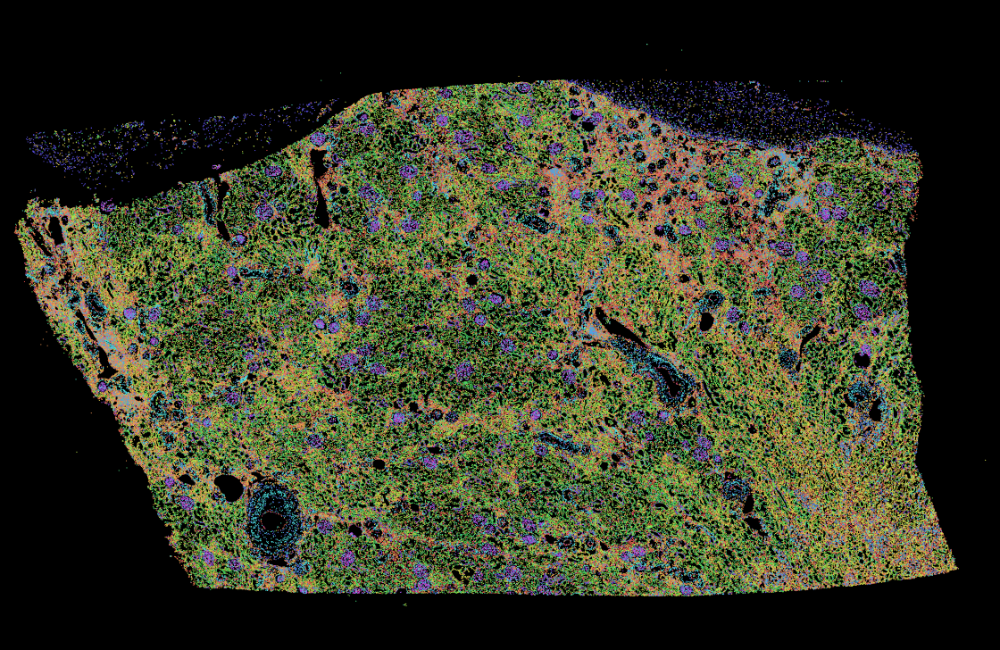](gallery_atera_kidney.md)
- [Atera Xenium Breast Cancer 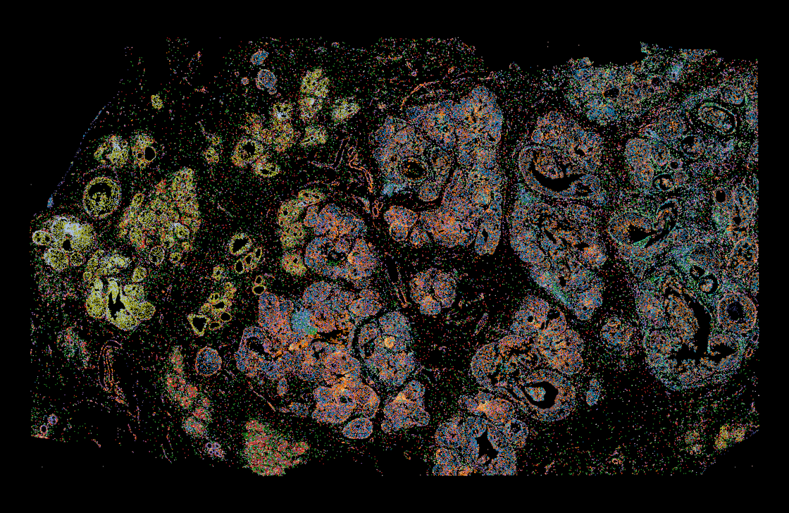](gallery_atera.md)

### Xenium

- [Xenium Mouse Brain 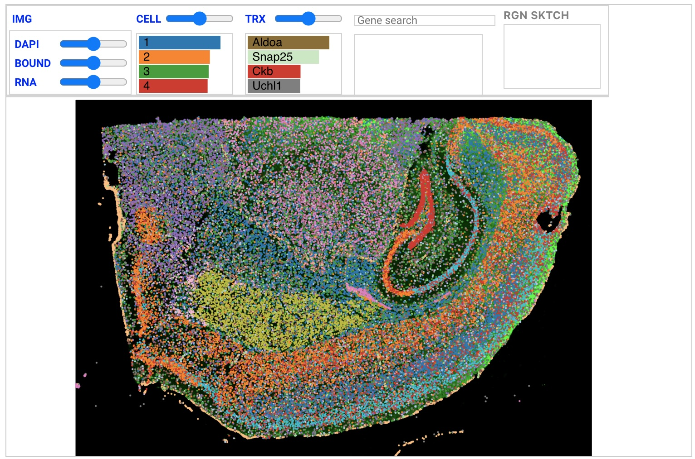](gallery_xenium_mouse_brain.md)
- [Xenium Human Skin Cancer 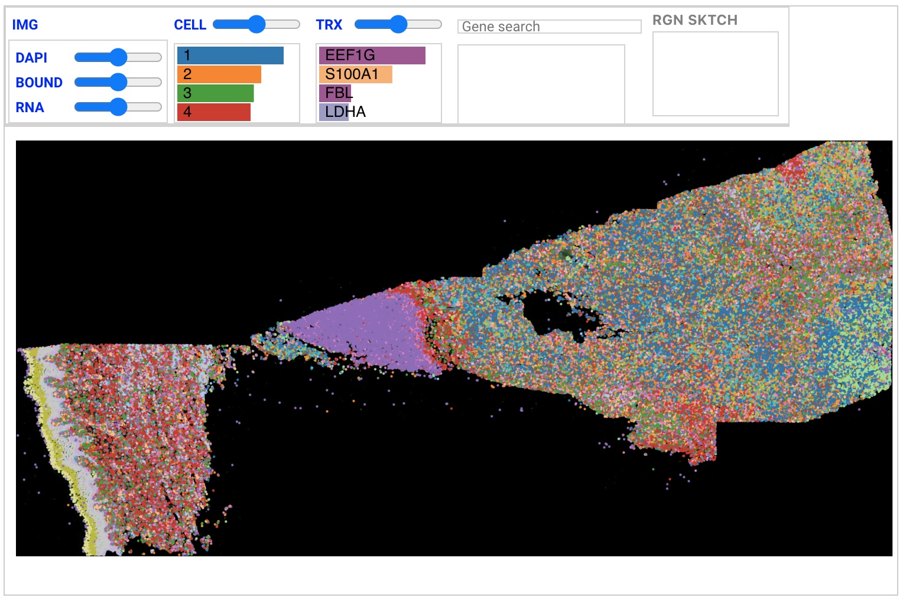](gallery_xenium_skin_cancer.md)
- [Broad-Allen Developing Mouse Brain E15.5: Slice 35 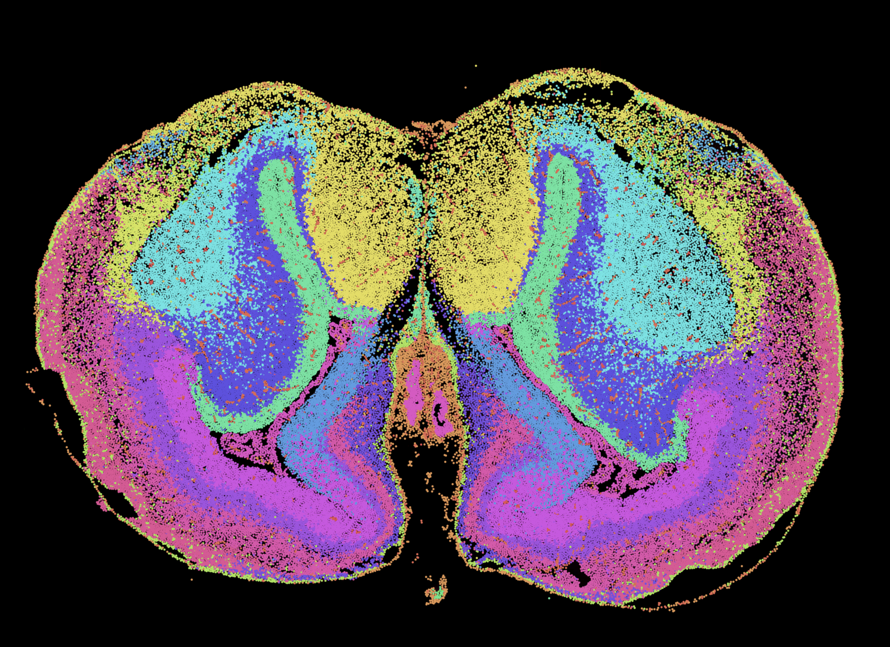](gallery_broad_allen_mouse_brain_2d.md)

### CosMx

- [CosMx Human Colon CRC (WTx) 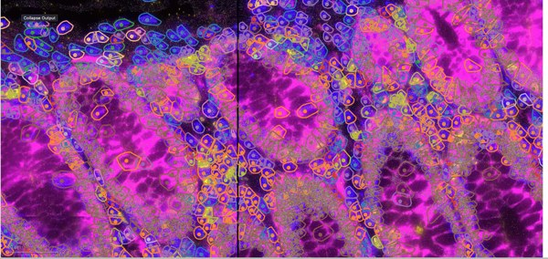](gallery_cosmx_human_colon.md)

### Visium HD

- [Visium HD Cell Segmentation Mouse Brain 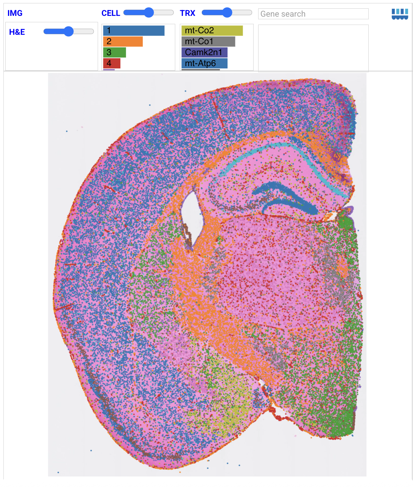{ width="300" }](gallery_visium_hd_cell_segmentation_mouse_brain.md)

## 3D CellClouds

Cells in three dimensions, from aligned serial sections or thick tissue, explored
with a [CellCloud](../visualizations/cell-cloud.md).

### Xenium serial sections

- [Broad-Allen Developing Mouse Brain E15.5: 3D 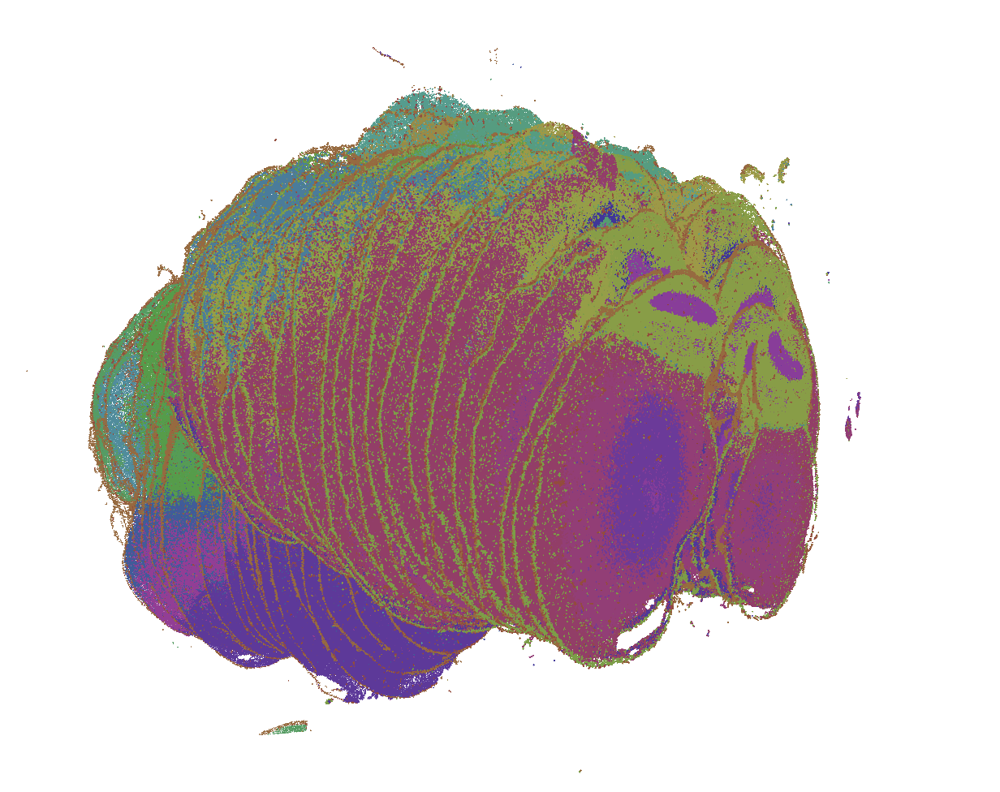](gallery_broad_allen_mouse_brain_3d.md)

### MERFISH thick tissue

- [Thick-Tissue MERFISH: 3D 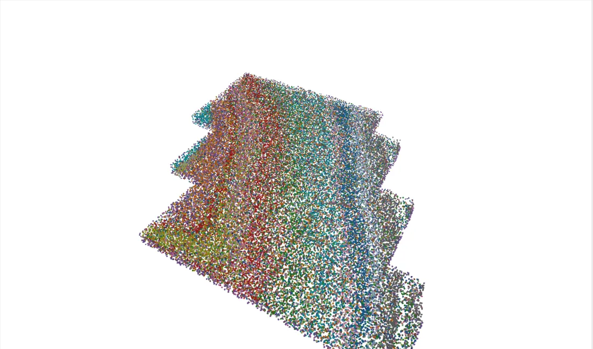](gallery_merfish_thick_tissue.md)

## Single-Cell Landscapes and Clustergrams

Single-cell data explored as UMAP [Landscapes](../visualizations/landscape/umap-xy.md)
and cell-type [Clustergrams](../visualizations/clustergram.md).

### Single-cell RNA-seq

- [Tabula Sapiens: Atlas UMAP and Cell-Type Signatures ](gallery_tabula_sapiens_clustergram.md)

    Explore 1.1 million cells in a single-cell RNA-seq atlas with a linked
    Landscape and Clustergram, or [open the UMAP alone](gallery_tabula_sapiens.md).
    Preview captured in [Celldega-App](../getting-started/desktop-app.md).

    Data: Tabula Sapiens Consortium, via
    [CZ CELLxGENE Discover](https://cellxgene.cziscience.com/collections/e5f58829-1a66-40b5-a624-9046778e74f5)
    · [CC BY 4.0](https://creativecommons.org/licenses/by/4.0/).

### CITE-seq: RNA and surface protein

- [CITE-seq PBMC Cell Types: RNA and Protein 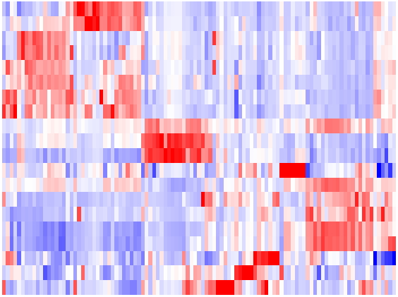](gallery_citeseq_pbmc.md)

## Web Presentations

- [Broad Retreat 2024: Data Visualization Breakout Session 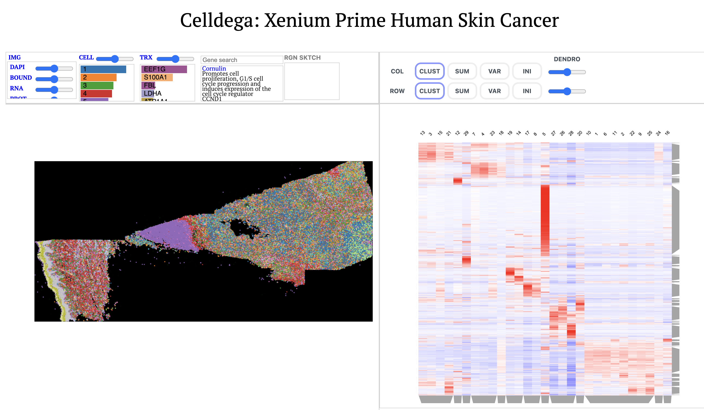](https://broadinstitute.github.io/Celldega-Broad-Retreat-2024/)

