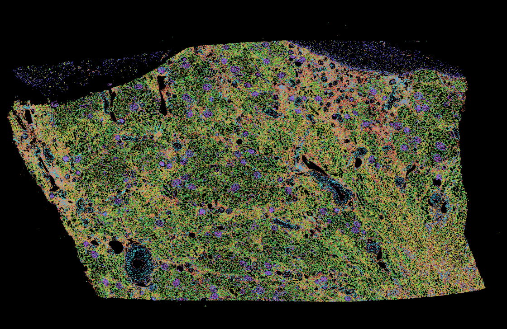
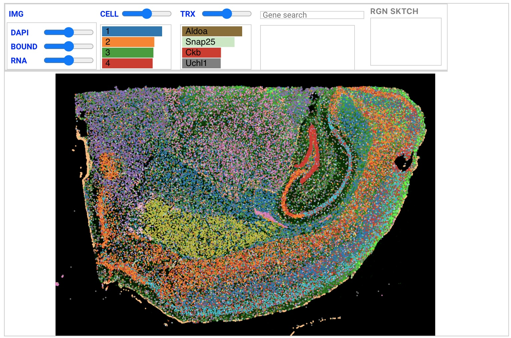
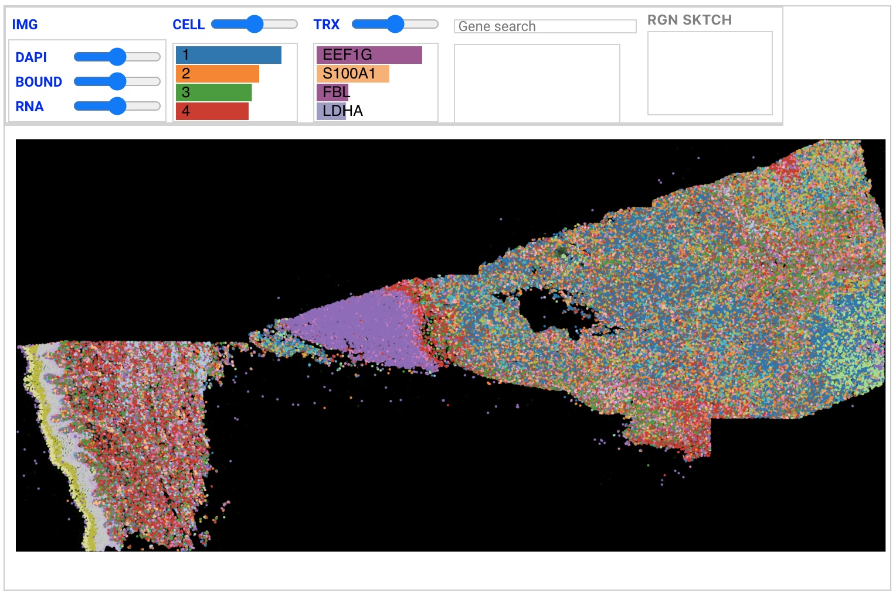
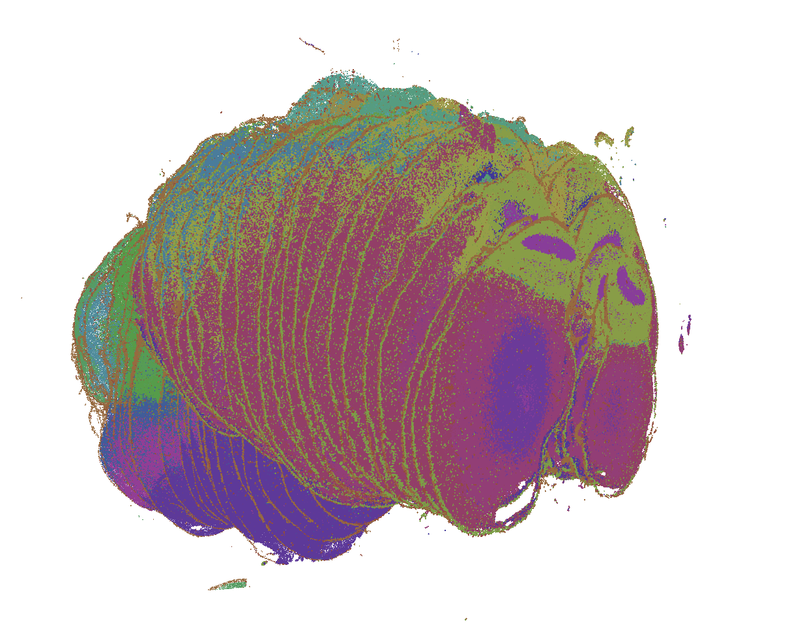
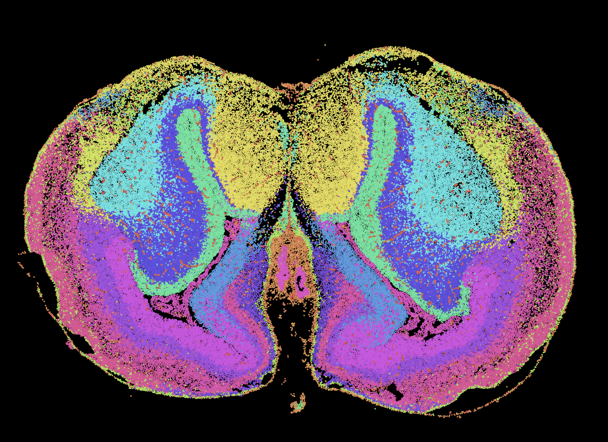
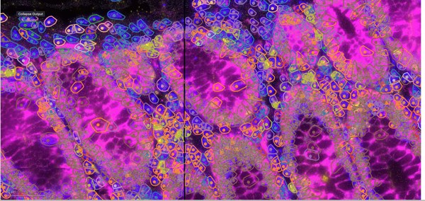
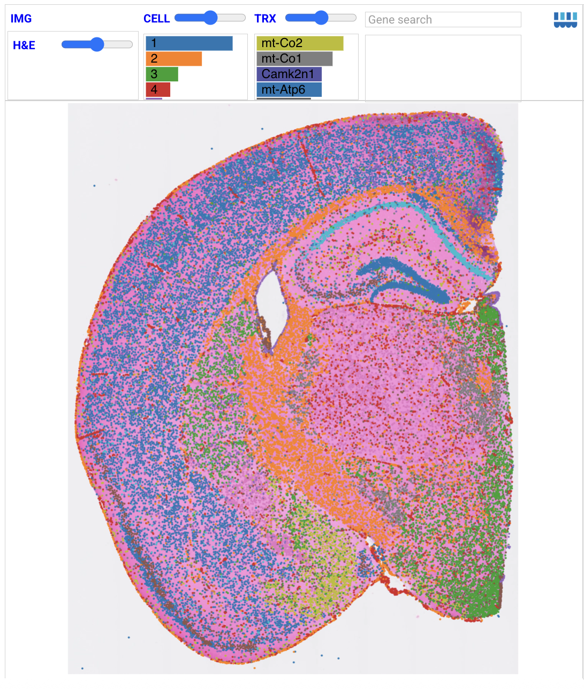
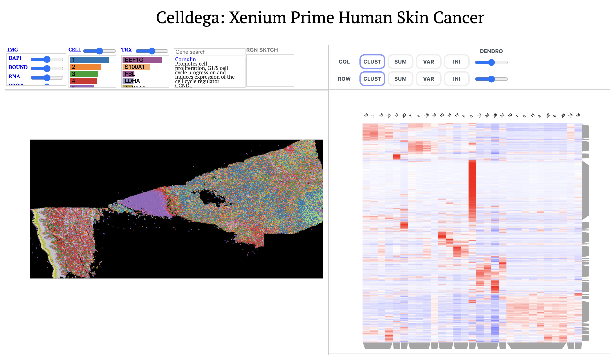

# Celldega Gallery

This gallery collects project web presentations and visualizations made with the stand-alone [Celldega JavaScript library](../javascript/index.md).

## Imaging Spatial Transcriptomics

### Atera

- [Atera Kidney non-diseased FFPE ](gallery_atera_kidney.md)
- [Atera Xenium Breast Cancer](gallery_atera.md)

### Xenium

- [Xenium Mouse Brain ](gallery_xenium_mouse_brain.md)
- [Xenium Human Skin Cancer ](gallery_xenium_skin_cancer.md)
- [Broad-Allen Developing Mouse Brain E15.5: 3D ](gallery_broad_allen_mouse_brain_3d.md)
- [Broad-Allen Developing Mouse Brain E15.5: Slice 35 ](gallery_broad_allen_mouse_brain_2d.md)

### CosMx

- [CosMx Human Colon CRC (WTx) ](gallery_cosmx_human_colon.md)

## Sequencing Spatial Transcriptomics

### Visium HD

- [Visium HD Cell Segmentation Mouse Brain { width="300" }](gallery_visium_hd_cell_segmentation_mouse_brain.md)

## Web Presentations

- [Broad Retreat 2024: Data Visualization Breakout Session ](https://broadinstitute.github.io/Celldega-Broad-Retreat-2024/)

