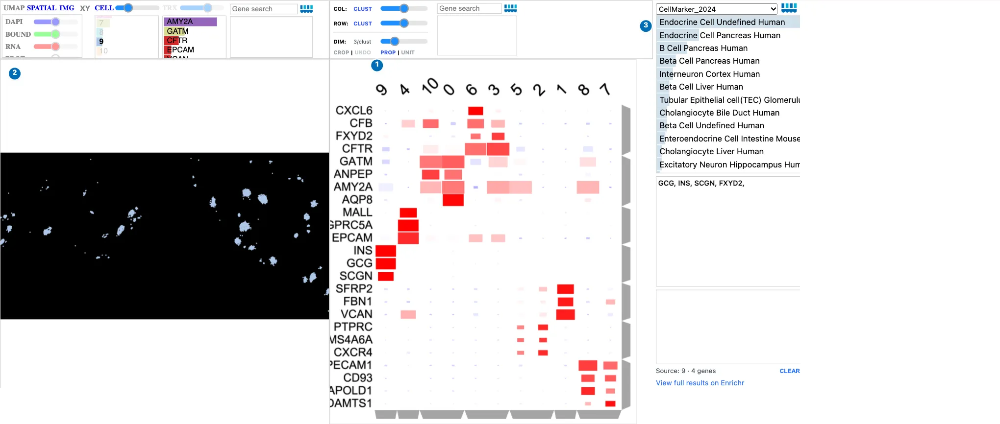

# Visualize Your Own Data

This guide follows a public 10x Genomics Xenium human pancreas dataset from the
instrument's output to linked views of your own analysis: your clusters over
the tissue and in a UMAP, a marker-gene dot plot, and gene-set enrichment. The
same steps apply to your own Xenium data. Run the code in a Jupyter or marimo
notebook.

```text
 Xenium output bundle
   │
   ├─ 1. pre.main ──► DegaFiles ──────────────┐
   │                                          ▼
   └─ 2. Scanpy ────► AnnData ──────────► 3. Landscape: clusters, UMAP
                         │                    ▲
                         │                    │ 5. linked
                         └─► 4. Matrix ─► Clustergram ─► Enrich
```

Each step's output for this dataset is already hosted, so you can start at any
step. To explore the prepared data before installing anything, try the
[Quick Start](index.md#2-explore-a-public-xenium-dataset).

## 1. Prepare DegaFiles from the instrument output

DegaFiles arrange the images, cells, transcripts, and expression so that the
browser can load only what is in view. Preprocessing needs the `pre` extra and
a native [libvips](https://www.libvips.org/install.html) installation:

```bash
pip install "celldega[pre]"
```

Download the Xenium output bundle from the
[10x Genomics dataset page](https://www.10xgenomics.com/datasets/ffpe-human-pancreas-with-xenium-multimodal-cell-segmentation-1-standard)
(a 5.7 GB zip), and unpack it:

```bash
mkdir -p data/xenium && cd data/xenium
curl -LO https://cf.10xgenomics.com/samples/xenium/2.0.0/Xenium_V1_human_Pancreas_FFPE/Xenium_V1_human_Pancreas_FFPE_outs.zip
unzip Xenium_V1_human_Pancreas_FFPE_outs.zip -d Xenium_V1_human_Pancreas_FFPE_outs
```

Then write the DegaFiles:

```python
import celldega as dega

dega.pre.main(
    sample="Xenium_V1_human_Pancreas_FFPE_outs",
    data_root_dir="data/xenium",
    path_dega_files="data/DegaFiles/pancreas",
    tile_size=250,
    image_tile_layer="all",
)
```

`pre.main` handles Xenium (including Atera) and MERSCOPE bundles; see the
[Atera preprocessing example](../examples/brief_notebooks/Atera_Pre-process.ipynb).
To view the DegaFiles, serve their directory over HTTP and pass the URL to a
Landscape:

```python
port = dega.viz.get_local_server(file_server_root="data/DegaFiles/pancreas")
landscape = dega.viz.Landscape(base_url=f"http://localhost:{port}")
landscape
```

To share them, upload the directory to GitHub, Hugging Face, or a cloud bucket;
see [Host and share prepared data](usage/index.md#host-and-share-prepared-data).
The rest of this guide uses the hosted DegaFiles for this dataset:

```python
base_url = (
    "https://raw.githubusercontent.com/broadinstitute/celldega_Xenium_human_Pancreas_FFPE/"
    "main/Landscape_Xenium_V1_human_Pancreas_FFPE_outs_webp"
)
```

## 2. Analyze with Scanpy

Read the cell-by-gene counts from the same output bundle, then cluster as usual
with [Scanpy](https://scanpy.readthedocs.io/):

```python
import scanpy as sc

outs = "data/xenium/Xenium_V1_human_Pancreas_FFPE_outs"
adata = sc.read_10x_h5(f"{outs}/cell_feature_matrix.h5")
adata.layers["counts"] = adata.X.copy()

sc.pp.filter_cells(adata, min_counts=10)
sc.pp.filter_genes(adata, min_cells=5)
sc.pp.normalize_total(adata)
sc.pp.log1p(adata)
sc.pp.pca(adata)
sc.pp.neighbors(adata)
sc.tl.umap(adata)
sc.tl.leiden(adata, flavor="igraph", n_iterations=2, directed=False)
```

This takes about two minutes for the 122,678 cells that pass the filter.
Celldega links your analysis to the DegaFiles by **cell ID**: `read_10x_h5`
names cells by their Xenium cell IDs (such as `aaaadnje-1`), the same IDs the
DegaFiles use. If you read the data another way, such as with
[spatialdata-io](https://spatialdata.scverse.org/projects/io/), set
`adata.obs_names = adata.obs["cell_id"].astype(str)` first.

## 3. See your clusters in the tissue

Pass the AnnData to the Landscape. Cells take your Leiden clusters and colors,
and the UMAP becomes available with the **UMAP** button:

```python
landscape = dega.viz.Landscape(base_url=base_url, adata=adata, cluster_attr="leiden")
landscape
```

Select a cluster in the UMAP, then switch to **SPATIAL** to see where those cells
are in the tissue; see
[Spaces and embeddings](../visualizations/landscape/index.md#spaces-and-embeddings),
which shows this dataset's islet cells moving between the two views.

## 4. Find marker genes with a dot-plot Clustergram

Rank each cluster's marker genes, then summarize the cells by cluster. In the
dot plot, color is a gene's mean expression in a cluster, scaled across clusters,
and dot size is the fraction of the cluster's cells that express it:

```python
import celldega as dega

sc.tl.rank_genes_groups(adata, groupby="leiden")

markers = dega.clust.Matrix(adata, groupby="leiden")
markers.filter_by_size(0.05)  # genes detected in at least 5% of a cluster's cells
markers.norm("row", by="zscore")
markers.cluster(view="rank_genes_groups", levels=[1, 3, 5, 10])

cgm = dega.viz.Clustergram(matrix=markers, rank_dim=3)
cgm
```

`cluster(view=..., levels=...)` precomputes views with 1, 3, 5, and 10 marker
genes per cluster; the **DIM** slider moves between them, and `rank_dim=3` opens
at three markers per cluster. See [Clustergram](../visualizations/clustergram.md)
for every interaction.

## 5. Link the views and interpret with Enrich

Link the Landscape and Clustergram, and add Enrich to look up the selected genes
in public gene-set libraries:

```python
dega.viz.spatial_clustergram(landscape, cgm, enrich=True)
```

[{ loading=lazy }](../assets/img/visualizations/your-data/linked.webp)

*Clicking the islet cluster's column (9 here) in the Clustergram.*

| | What happened |
| --- | --- |
| 1 | Clicking the cluster's column label selected it. Its markers, *INS*, *GCG*, and *SCGN*, mark insulin- and glucagon-producing islet cells. |
| 2 | The Landscape shows only that cluster's cells: the islets, scattered through the pancreas. |
| 3 | Enrich received the cluster's top marker genes and ranks endocrine and beta cell gene sets first. |

Clicking a gene's row label colors the cells by that gene, and a row dendrogram
branch sends a group of genes to Enrich. Your Leiden numbers may differ from
this example's. See
[Landscape–Clustergram–Enrich](../visualizations/landscape-clustergram-enrich.md)
for more linked workflows.

## 6. Save and share

Save the clustered dot plot so that it reopens without recomputing, in Python or
in a web page:

```python
markers.write_zarr("pancreas_markers.zarr")
restored = dega.clust.Matrix.read_zarr("pancreas_markers.zarr")
```

A notebook saved with its widget state can be published as an interactive
report, as the [example notebooks](../examples/index.md) on this site are; see
[two ways to use a visualization](../visualizations/index.md#two-ways-to-use-a-visualization).

## Next steps

- [From Scanpy & Squidpy](from-scanpy.md): what Celldega reads from your AnnData,
  and how to bring selections and annotations back into it.
- [Visualizations](../visualizations/index.md): every interaction in Landscape,
  Clustergram, and the other views.
- [Neighborhoods](../visualizations/landscape/neighborhoods.md): draw regions,
  such as islets, and summarize the cells inside them.
- [Scanpy–Squidpy Xenium pancreas tutorial](../examples/tutorial_notebooks/Scanpy-Squidpy_Xenium_Pancreas.ipynb):
  add Squidpy's spatial neighborhood enrichment.
- [Chromium PBMC tutorial](../examples/tutorial_notebooks/Scanpy_Chromium.ipynb):
  the same steps for single-cell data, which need no DegaFiles.

## Screenshot sources

The screenshot shows the hosted pancreas DegaFiles with the
[hosted Scanpy AnnData](https://huggingface.co/datasets/broadinstitute/Celldega_Supporting_Data/blob/main/Xenium_V1_human_Pancreas_FFPE_outs.h5ad)
for this dataset, captured with Celldega 0.28.0 using
[`scripts/docs_screenshots/capture.py`](https://github.com/broadinstitute/celldega/tree/main/scripts/docs_screenshots).
The code on this page was run with Celldega 0.28.0 on the 10x output bundle.
Data: 10x Genomics, FFPE Human Pancreas with Xenium Multimodal Cell Segmentation.
