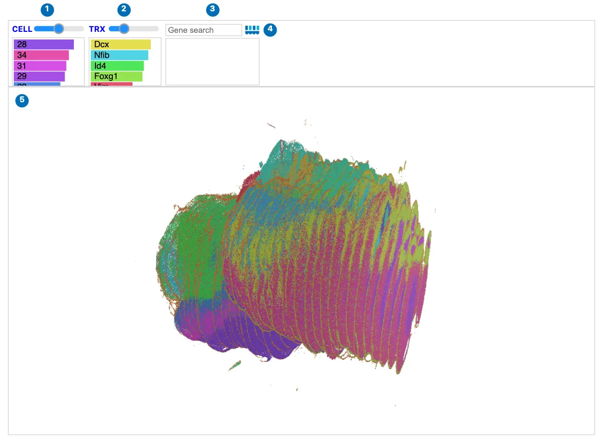
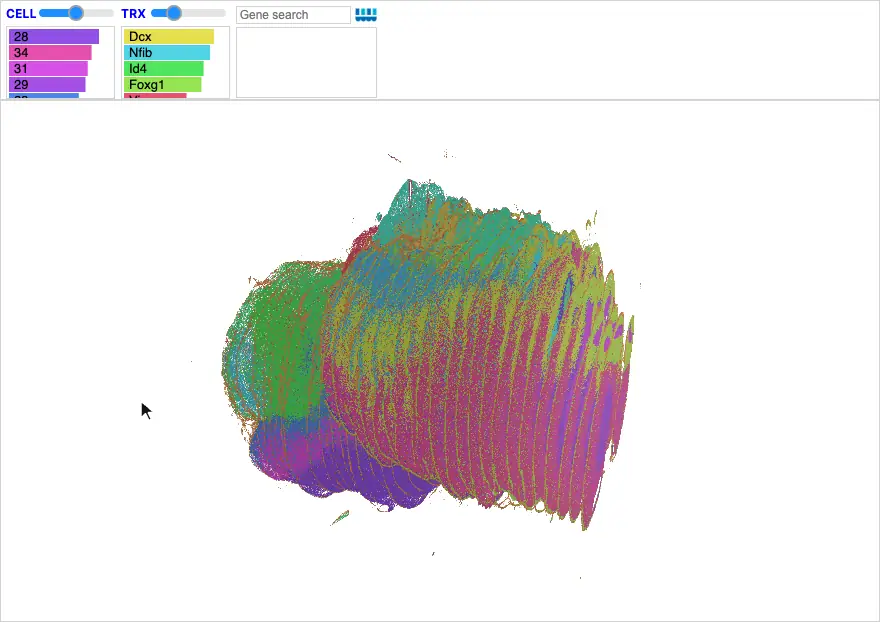

# CellCloud

`CellCloud` shows cells in 3D, as points you can rotate and zoom. Use it for
data with depth, such as thick tissue or serial sections aligned into a stack,
to see how cell types and gene expression are arranged through the tissue. For
2D detail, such as images, cell boundaries, and transcripts, use a
[Landscape](landscape/index.md).

<div class="viz-preview">
  <p class="viz-preview-status" role="status">Loading an interactive preview…</p>
  <div id="preview-cell-cloud"></div>
</div>

*Interactive preview: 76,356 cells imaged in 3D with thick-tissue MERFISH. Drag
to orbit and scroll to zoom. Open the [full-size view](../gallery/gallery_merfish_thick_tissue.md)
in the Gallery.*

## Reading a CellCloud

Each point is a cell, colored by its cluster or by a gene's expression. The
control panel matches a Landscape's, without the image and transcript layers,
which have no 3D form.

[](../assets/img/visualizations/cell-cloud/overview.webp)

*3.8 million cells from 43 aligned Xenium sections of an E15.5 mouse brain,
colored by cluster.*

| | Control | What it does |
| --- | --- | --- |
| 1 | **CELL** | The slider scales the point size, from 0 to twice `cell_size`. Click a cluster's bar to show only its cells; click again to show all. |
| 2 | Genes | Click a gene's bar to color cells by its expression. |
| 3 | Gene search | Color cells by one or more genes, typed by name. |
| 4 | Celldega logo | Opens this page. |
| 5 | The view | Drag to rotate, scroll to zoom, and hover for details. |

## Rotating and zooming

Drag to rotate the cells around their center, horizontally and vertically, all
the way around and past the poles. Scroll to zoom. Hover over a cell for its ID
and cluster; tooltips pause briefly after the view moves, so that rotating stays
smooth. Click a cell to select its cluster.

[{ width="880" loading=lazy }](../assets/img/visualizations/cell-cloud/orbit.webp)

*Turning the mouse brain fully around and tilting it, selecting cluster 2, and
searching for SPARC, which outlines the meninges around the brain.*

## Widget: Python-backed interactions

A CellCloud responds to Python and to linked views: a linked Clustergram's clicks
color or select its cells, and setting `cell_size` updates the point size. It
does not send selections back to Python; use a Landscape of the same cells for
that.

## Usage

### Choose a data source

Use `base_url` for point-cloud DegaFiles or `zarr_url` for a cell-level
AnnData Zarr store. The browser reads positions, categories, and the selected
genes directly from either source; an in-memory AnnData is optional.

When testing the unreleased checkout, run `npm run build` and start the notebook
kernel with `CELLDEGA_LOCAL_ESM=1` before importing Celldega to use its new reader.

```python
import celldega as dega

# Point-cloud DegaFiles served from a directory under the working directory.
port = dega.viz.get_local_server()
from_degafiles = dega.viz.CellCloud(
    base_url=f"http://localhost:{port}/data/cell_cloud_files",
    cluster_attr="cell_type",
    alignment="neighborhood",
    rotation_x=20,
)

# An AnnData Zarr store, served automatically when given a local path.
from_zarr = dega.viz.CellCloud(
    zarr_url="data/cells.zarr",
    cluster_attr="cell_type",
    alignment="neighborhood",
    rotation_x=20,
)

from_degafiles  # display this widget, or from_zarr
```

Both arguments also accept HTTP(S) URLs. Pass one source per widget. Zarr
stores use CSC expression in `X` or a layer selected with `zarr_layer`.
Positions come from `obsm["spatial"]` (XYZ), or
`obsm["spatial_<alignment>"]` for a named alignment. Original `obs_names`
remain the cell IDs used by tooltips, selections, and linked visualizations.

`cell_size` sets the default cell diameter (10 µm by default), assuming the
centroid coordinates are in microns. The **CELL** slider scales this diameter
from 0× to 2×; its initial midpoint is 1×. You can also update
`cell_cloud.cell_size` after displaying the widget, preserving the slider's
current multiplier.

Drag to rotate continuously around both orbit axes, including past the poles.

### Prepare either format

Start with cell-level `adata`: positions in `obsm["spatial"]` (XY or XYZ),
an optional Z column such as `obs["Z"]`, expression in `layers["counts"]`
or `X`, and categories in an `obs` column.

```python
# Compact Parquet files: retain original IDs once and use numeric indices elsewhere.
dega.pre.write_point_cloud_dataset(
    adata,
    "data/cell_cloud_files",
    name="neighborhood",
    cluster_key="cell_type",
    use_int_index=True,
    coordinate_resolution=1.0,
    compression="zstd",
    compression_level=6,
)

# A self-contained AnnData Zarr with CSC expression and the same positions.
dega.pre.write_point_cloud_zarr(
    adata,
    "data/cells.zarr",
    cluster_key="cell_type",
    alignments={"neighborhood": xyz},  # (n_cells, 3), in adata.obs_names order
    coordinate_resolution=1.0,
)
```

Here `xyz` contains the alignment's XYZ positions in microns. If `spatial`
already has three columns and no separate Z column should take precedence,
pass `z_key=None` to either writer. Omit `alignment` when displaying a store
that contains only the default positions.

With micron inputs, `coordinate_resolution=1.0` rounds each axis to the nearest
micron (at most 0.5 µm of error per axis). Numeric IDs and compression reduce
file transfer and decoding work while preserving original cell identity.
The DegaFiles writer keeps its existing name-based defaults unless these
options are selected. The Zarr writer requires a new output path by default.

Passing `name="..."` to the DegaFiles writer adds a named position variant.
For an indexed dataset, appended alignments must contain exactly the same
cells; the writer restores their canonical order. See the
[pre module API](../python/pre/api.md) and
[File Formats](../getting-started/file_formats.md#point-cloud-degafiles).

`CellCloud` can also be linked to a `Clustergram`, exactly like `Landscape`
— see [`dega.viz.spatial_clustergram`](../python/viz/api.md).

For the full list of constructor arguments, see the
[Viz Module API reference](../python/viz/api.md).

## Examples

Explore the [3D developing mouse brain](../gallery/gallery_broad_allen_mouse_brain_3d.md)
interactively, or follow its
[visualization notebook](../examples/tutorial_notebooks/Broad-Allen_Dev-Mouse-Brain_E15.5_Viz.ipynb)
for a CellCloud linked to a Clustergram. The companion
[preprocessing and alignment notebook](../examples/tutorial_notebooks/Broad-Allen_Dev-Mouse-Brain_E15.5_Align.ipynb)
shows how to build the stack and write DegaFiles. For thick tissue, see the
[MERFISH notebook](../examples/brief_notebooks/Landscape-3D_thick_MERFISH.ipynb).

## Screenshot sources

The screenshot and animation show the
[Broad–Allen developing mouse brain](../gallery/gallery_broad_allen_mouse_brain_3d.md)
compact DegaFiles, captured with Celldega 0.28.0 using
[`scripts/docs_screenshots/capture.py`](https://github.com/broadinstitute/celldega/tree/main/scripts/docs_screenshots).
