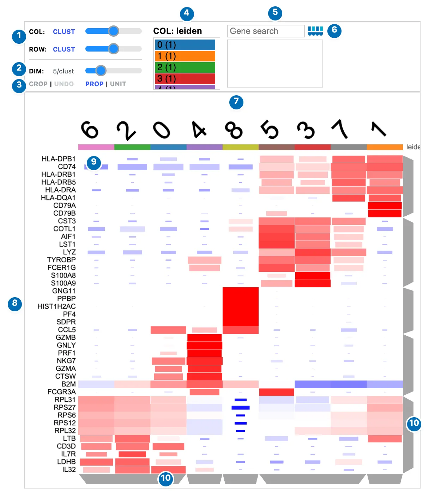
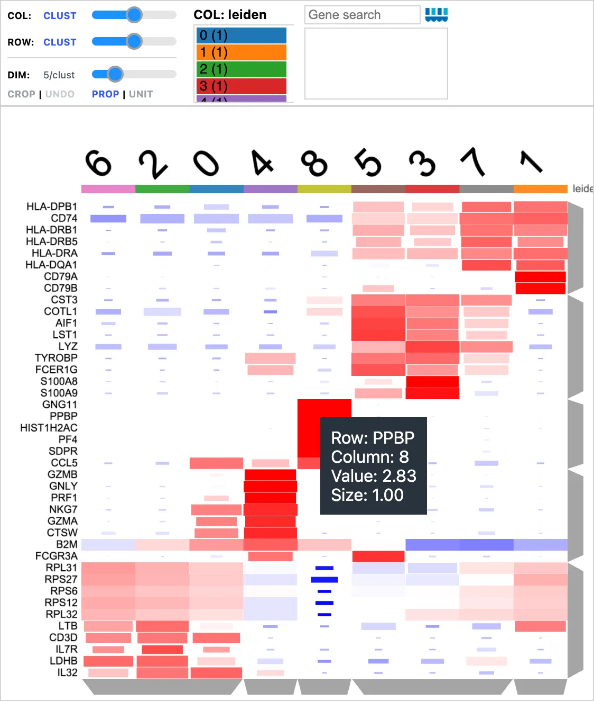
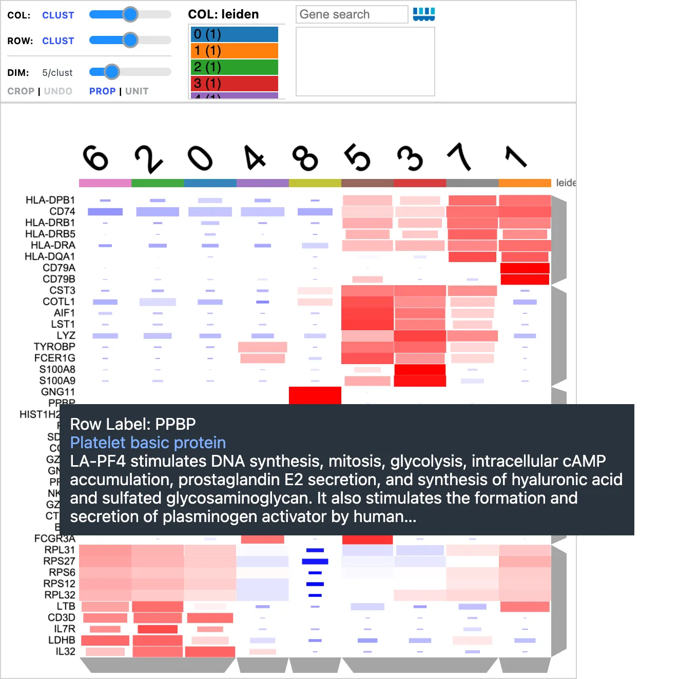
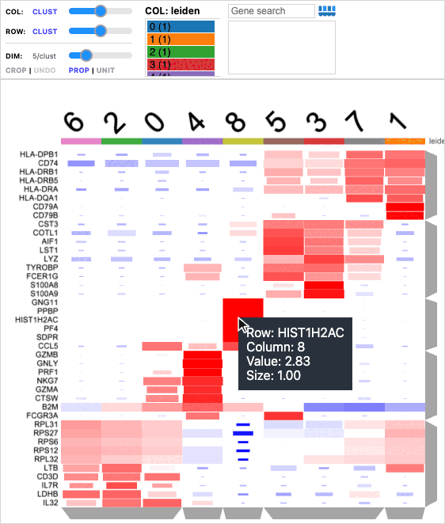
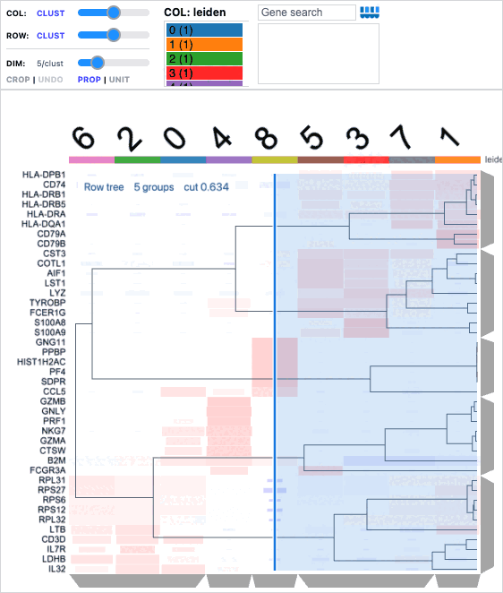
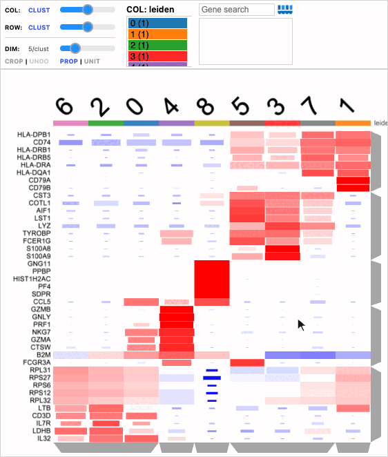
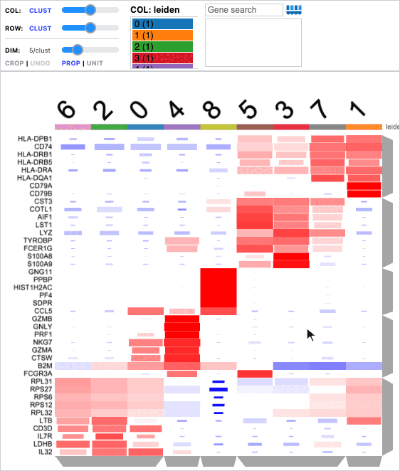
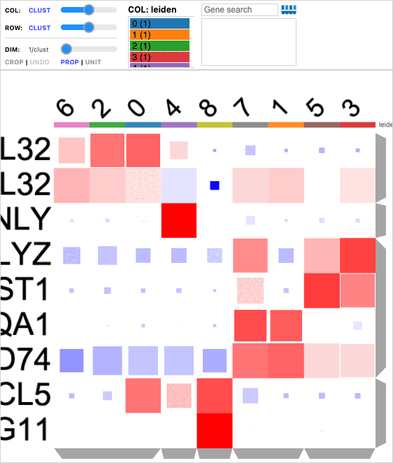
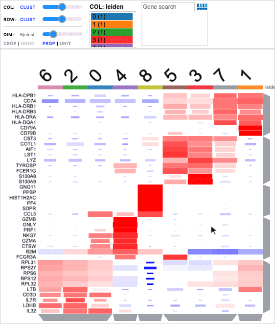
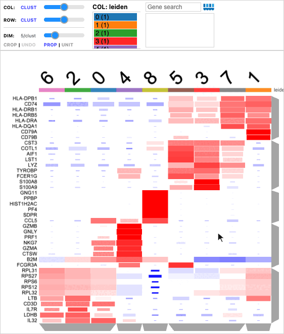

# Clustergram

`Clustergram` uses **hierarchical bi-clustering** to organize both axes of a
high-dimensional matrix: genes/features by their expression patterns, and
cells, clusters, neighborhoods, or samples by their similarity. The heatmap
or dot plot makes these relationships visible alongside dendrograms.

For single-cell expression, a common workflow starts by identifying cell
groups with tools such as
[Scanpy's Leiden clustering](https://scanpy.readthedocs.io/en/stable/generated/scanpy.tl.leiden.html).
Celldega can summarize expression within those groups, then hierarchically
cluster the genes and groups to explore marker programs and relationships
between cell populations.

<div class="viz-preview">
  <p class="viz-preview-status" role="status">Loading an interactive preview…</p>
  <div id="preview-clustergram"></div>
</div>

*Interactive preview: top marker genes of 180 Tabula Sapiens cell types. Color
shows mean expression scaled per gene; dot size shows the fraction of cells
expressing the gene. Use **DIM** to change the number of markers per cell type.
Data: Tabula Sapiens Consortium, via
[CZ CELLxGENE Discover](https://cellxgene.cziscience.com/collections/e5f58829-1a66-40b5-a624-9046778e74f5)
· [CC BY 4.0](https://creativecommons.org/licenses/by/4.0/).*

## Reading a Clustergram

A Clustergram arranges a matrix so that similar rows sit next to each other, and
so do similar columns. In the marker dot plot below, rows are genes and columns
are Leiden clusters of peripheral blood mononuclear cells (PBMCs). Each mark's
**color** shows a gene's mean expression in a cluster, scaled across clusters:
red is above the gene's average and blue is below. Its **size** shows the
fraction of the cluster's cells that express the gene. The dendrograms on the
right and bottom show how genes and clusters were grouped, so blocks of red
reveal marker programs: B-cell genes such as *CD79A* in cluster 1, platelet genes
such as *PPBP* and *PF4* in cluster 8, and NK-cell genes such as *GZMB* and
*NKG7* in cluster 4.

[{ width="600" }](../assets/img/visualizations/clustergram/overview.webp)

*Marker genes of nine PBMC clusters, five per cluster, as a dot plot.*

| | Control | What it does |
| --- | --- | --- |
| 1 | **COL** / **ROW** | Order each axis (**CLUST**, **SUM**, **VAR**, or **INI**), and cut its dendrogram with the slider. |
| 2 | **DIM** | Choose how many genes to show, from views precomputed in Python; here, five markers per cluster. |
| 3 | **CROP** · **UNDO** · **PROP** · **UNIT** | Crop to a region and undo the crop; switch dot-plot marks between proportional and full size. |
| 4 | Category bars | Count the categories in view, such as clusters. Hover a bar to highlight its rows or columns. |
| 5 | Search | Find a gene and zoom to it. The box below describes a clicked gene. |
| 6 | Celldega logo | Opens this page. |
| 7 | Column labels | Cluster names, above a colored strip for each column category. |
| 8 | Row labels | Gene names. Hover for a description; click to send the gene to linked views. |
| 9 | Matrix | One mark per gene and cluster. Hover for its values. |
| 10 | Dendrograms | The row (right) and column (bottom) clustering trees. Hover or click a branch to select its group. |

Many of these interactions build on
[Clustergrammer](https://clustergrammer.readthedocs.io/)
([Fernandez et al., *Scientific Data*, 2017](https://www.nature.com/articles/sdata2017151)),
whose [interaction guide](https://clustergrammer.readthedocs.io/interacting_with_viz.html)
describes the original designs. For stacked cell-type proportions across groups,
use [Composition](composition.md).

## Motivation for Clustergram and Matrix

We usually describe Clustergrams with cells and genes, but the analysis is
generic: any matrix of **observations** and **dimensions** can be explored this
way.

### Clusters of observations and of dimensions

Graph-based clustering, such as Scanpy's
[Leiden clustering](https://scanpy.readthedocs.io/en/stable/generated/scanpy.tl.leiden.html),
assigns each cell to a cluster but does not show how the clusters relate to each
other or which genes they share. A Clustergram hierarchically clusters **both**
axes. Clustering the Leiden clusters' expression signatures gives a
meta-clustering that groups related clusters, such as T-cell subtypes. Clustering
the genes finds programs of co-expressed genes, such as the NK-cell cytotoxicity
genes above, and shows which cell groups share them.

### A viewer for a DataFrame or an AnnData

[`dega.clust.Matrix`](../python/clust/api.md) prepares a pandas DataFrame or an
[AnnData](https://anndata.readthedocs.io/) for hierarchical bi-clustering: it
holds the values, the row and column annotations, the clustering, and any
precomputed views. A Clustergram displays a Matrix, so you can think of it as an
interactive viewer for your DataFrame or AnnData, with clustering on both axes.

### Observations as columns

A Clustergram shows **observations as columns and dimensions as rows**, the
transpose of AnnData's observations × variables:

| AnnData | Clustergram |
| --- | --- |
| Observations (`obs_names`): cells, clusters, samples | Columns |
| Variables (`var_names`): genes, proteins | Rows |
| `obs` columns, such as `leiden` or `sample` | Colored strips above the columns |
| `var` columns | Colored strips beside the rows |
| `X` | The matrix, transposed |

Observations usually carry more annotations than dimensions: cluster, sample,
condition, cell type, and so on. With observations as columns, each annotation
becomes a horizontal band of color above the matrix, and a stack of horizontal
bands is easier to read than a row of vertical ones. Celldega transposes for
you when it reads an AnnData and when it saves a Matrix.

### Views of marker-gene rankings

Scanpy's
[`rank_genes_groups`](https://scanpy.readthedocs.io/en/stable/generated/scanpy.tl.rank_genes_groups.html)
ranks marker genes for each cluster, and a marker plot usually shows one choice
of how many genes to include. Celldega precomputes **views** at several levels,
such as 1, 3, 5, and 10 markers per cluster, each clustered on its own. The
**DIM** slider then lets you move between them interactively. See
[views at different feature resolutions](#generate-views-at-different-feature-resolutions).

### Dot size: the fraction of cells expressing a gene

`Matrix(adata, groupby="leiden")` summarizes cells by group: color is the group's
mean expression, and dot size is the fraction of its cells with expression
greater than zero, as in Scanpy's
[dot plots](https://scanpy.readthedocs.io/en/stable/generated/scanpy.pl.dotplot.html).
A gene can have a high mean because a few cells express it strongly, or because
most cells express it moderately; dot size tells these apart. See
[the marker-gene dot plot example](#a-marker-gene-dot-plot-after-leiden-clustering).

### Saving the results in AnnData

AnnData has no standard place for hierarchical clustering of observations and
variables. When you save a clustered Matrix with `Matrix.write_zarr`, Celldega
stores the dendrograms, node orders, views, and colors in an ordinary AnnData
Zarr store under Celldega-specific keys (`uns["celldega"]`,
`obsm["celldega_nodes"]`, and `varm["celldega_nodes"]`). Python and the browser
can both reopen the same store without reclustering. Separately, for a
single-cell Landscape, Celldega reads cell-level expression from a CSC copy of
the expression matrix, which lets the browser fetch one gene at a time. See
[File Formats](../getting-started/file_formats.md#anndata-zarr-before-and-after-matrix-clustering)
for both layouts.

### Beyond cells and genes

The same methods cluster any observations and dimensions. The
[Atera breast cancer neighborhoods tutorial](../examples/tutorial_notebooks/Atera_Breast_Cancer_Neighborhood_Exploration.ipynb)
clusters tissue neighborhoods by their cell-type composition, and the
[Scanpy–Squidpy Xenium pancreas tutorial](../examples/tutorial_notebooks/Scanpy-Squidpy_Xenium_Pancreas.ipynb)
clusters cell types by their neighborhood enrichment.

## Zooming and panning

Scroll to zoom and drag to pan. When a Clustergram has many more rows than
columns, zooming first spreads the rows apart until the marks are about square,
then zooms both axes. Scrolling over the labels or dendrograms zooms from that
edge of the matrix. You cannot zoom out beyond the whole matrix.

[{ width="562" loading=lazy }](../assets/img/visualizations/clustergram/zoom_pan.gif)

*Scrolling spreads the rows apart first, then zooms both axes; dragging pans; scrolling back out returns to the whole matrix.*

## Hovering for details

Hovering shows information without changing anything:

- **A mark**: its gene, column, value, and, in a dot plot, its size.
- **A gene label**: the protein name and a description from
  [UniProt](https://www.uniprot.org/), for human gene symbols.
- **A dendrogram branch**: the members of that group (dimming the rest).
- **A category tile**: its category, with matching tiles highlighted.

[{ width="562" loading=lazy }](../assets/img/visualizations/clustergram/matrix_tooltip.webp)

*The platelet gene PPBP in cluster 8: its scaled mean expression (value) and the fraction of cells expressing it (size).*

[{ width="680" loading=lazy }](../assets/img/visualizations/clustergram/gene_tooltip.webp)

*Hovering a gene label shows its UniProt name and description.*

## Reordering rows and columns

The **COL** and **ROW** dropdowns order each axis by **CLUST** (the dendrogram),
**SUM** (total value), **VAR** (variance), or **INI** (the original order). The
reordering is animated so that you can follow the rows and columns. Dendrograms
appear only in **CLUST** order.

Double-click a gene's label to sort the columns by that gene, from highest to
lowest; the label turns blue and **COL** reads **CUSTOM**. Double-click a column
label to sort the genes by that column, or double-click a category title, such
as `leiden` beside the strip, to group that axis by category.

[{ width="562" loading=lazy }](../assets/img/visualizations/clustergram/reorder.gif)

*Double-clicking GZMB sorts the clusters by its expression (NK cluster 4 first); ROW → SUM sorts the genes by total; CLUST restores the dendrogram order.*

## Dendrograms

Each dendrogram slider sets where its tree is cut into groups. While you drag
it, a preview draws the whole tree over the matrix, with a blue cut line and the
number of groups. Release the slider, or press ++esc++, to hide the preview. The
slider is unavailable while that axis is cropped.

[{ width="562" loading=lazy }](../assets/img/visualizations/clustergram/dendrogram_slider.gif)

*Moving the ROW slider cuts the gene tree into more or fewer groups.*

Hover a branch, the gray trapezoids along the right and bottom, to see its
members and dim everything else. Click it to select the group: a gene group
colors linked cells by the genes' combined expression and can be sent to
Enrich. Click it again to clear the selection. Double-click a branch to crop to
that group, and double-click again to restore the axis.

[{ width="562" loading=lazy }](../assets/img/visualizations/clustergram/dendrogram_branch.gif)

*Hover the platelet branch to see its genes, click to select it, double-click to crop to it, and double-click again to restore the rows.*

## Categories

Colored strips beside the labels show each row's or column's categories, such
as its Leiden cluster. The category bars in the control panel count the
categories in view. When an axis has more than one category, choose which to
show from the dropdown. Hover a bar or a strip tile to highlight the matching
rows or columns.

To annotate interactively, create the Clustergram with
`manual_col_cat="cell_type"` (or `manual_row_cat`). Clicking a column's category
tile then opens an editor where you can name its category and choose a color,
for example to label each cluster with a cell type. The annotations are
available in Python as `cgm.manual_cat`.

## Cropping

Click **CROP**, then drag a rectangle over the matrix to keep only the rows and
columns inside it. **CROP** stays unavailable until you click **UNDO**, which
restores the whole matrix. To crop one axis to a dendrogram group,
double-click its branch.

[{ width="562" loading=lazy }](../assets/img/visualizations/clustergram/crop.gif)

*CROP, then drag a rectangle: the Clustergram keeps the monocyte, platelet, and NK-cell genes across all clusters. UNDO restores the matrix.*

## Changing the number of dimensions

When a Matrix has precomputed views (see
[views at different feature resolutions](#generate-views-at-different-feature-resolutions)),
the **DIM** (dimensions) slider steps through them, ending with **all** rows. The readout
shows the level, such as `5/clust` for five marker genes per cluster; hover it to
see how the genes were ranked. Each view is clustered on its own, so the order
of the columns can change.

[{ width="562" loading=lazy }](../assets/img/visualizations/clustergram/dim_slider.gif)

*Stepping DIM from 1 to 50 marker genes per cluster (9 to 310 genes), then back to 5. Each view is clustered on its own.*

## Proportional or full-size marks

In a dot plot, **PROP** sizes each mark by its size value, such as the fraction
of cells expressing the gene. **UNIT** draws every mark at full size, keeping
the colors, which makes weak or rare expression easier to compare.

[{ width="562" loading=lazy }](../assets/img/visualizations/clustergram/prop_unit.gif)

*UNIT draws full-size marks, revealing weak and negative values; PROP restores sizes by the fraction of cells expressing each gene.*

## Searching

Type a gene name in the search box and press ++enter++, or choose it from the
suggestions. The Clustergram zooms to the gene and bolds its label. Searching
does not select the gene; click its label to send it to linked views.

[{ width="562" loading=lazy }](../assets/img/visualizations/clustergram/search.gif)

*Searching for GZMB, then CD79A: the Clustergram zooms to each gene and bolds its label.*

## Linking to other visualizations

Linked to a Landscape, CellCloud, or NeighborhoodCloud, and to Enrich, a
Clustergram drives the other views:

| In the Clustergram | Landscape or CellCloud | Enrich |
| --- | --- | --- |
| Click a gene label | Colors cells by that gene; click again to return to clusters | — |
| Click a column label | Selects that cluster's cells | Receives the column's top marker genes |
| Click a column dendrogram branch | Selects those clusters' cells | — |
| Shift-click column labels | Selects those clusters' cells (shift-click again to remove one) | Receives their top marker genes |
| Click a row dendrogram branch, or crop rows | Colors cells by the genes' combined expression | Receives those genes |
| Shift-click gene labels | Colors cells by the genes' combined expression | Receives those genes |
| Click a mark | Colors cells by that gene within that cluster | — |

Selecting an Enrich term turns its genes' labels blue in the Clustergram, and
clicking a gene in Enrich zooms the Clustergram to it. Shift-clicked labels are blue
too, until a plain click starts over. With `dega.viz.spatial_clustergram`, the clusters
highlighted in the Landscape (from its cluster bars, a Clustergram click or a Clerk
link) turn their column labels blue (`cgm.highlighted_cols`); other Landscape
selections do not change the Clustergram. See
[Landscape–Clustergram–Enrich](landscape-clustergram-enrich.md) for a complete
linked example.

## Widget: Python-backed interactions

As a notebook widget, a Clustergram also shares its state with Python:

- **Selections**: `cgm.selected_genes`, `cgm.selected_rows`, and
  `cgm.selected_cols` hold the latest selection; `cgm.enrichment_genes` holds the
  gene set sent to Enrich; and `cgm.click_info` describes the last click.
- **Annotations**: categories assigned in the manual category editor are in
  `cgm.manual_cat`.
- **Updates from Python**: for example, `cgm.viz_mode = "heatmap"` switches a
  dot plot to a heatmap. `cgm.apply_state({...})` sets controls by name:
  `marker_level` (the DIM slider, or `"all"`), `mode` (`"heatmap"` /
  `"dotplot"`), `size` (`"prop"` / `"unit"`), `focus_gene` (zoom to a gene, like
  the search box), and `categories` (see below).
- **Annotations from Python**: `cgm.set_categories({"4": "Goblet cells", "5":
  "Plasma cells"})` labels columns in the manual category, exactly as the editor
  would; the strips, bars and `cgm.manual_cat` update. Pass `axis="row"` for rows,
  `attribute=...` to choose or create the category, `colors={...}` for colors, and
  `replace=True` to clear the axis's other labels first.
- **Snapshots**: `cgm.request_state()` asks the browser what is shown (rows and
  columns on screen, order, marker level, dendrogram groups, attributes, selection,
  values); `cgm.request_state(markers={"clusters": ["4"], "n": 25})` also returns
  a cluster's ranked `rank_genes_groups` markers. Read `cgm.latest_state` in a
  later cell.
- **Images**: `cgm.request_raster()` captures the heatmap (with its labels and
  category strips) as a PNG, like the Landscape's; read `cgm.raster_png` (and the
  `cgm.raster_thumb` preview) in a later cell. Captures stay in memory and are never
  saved into the notebook. In JavaScript, `matrix.capture_raster()` returns the same.
  To save a PNG file that can be reopened, use `cgm.screenshot()` (see
  [Screenshots](index.md#screenshots)).

```python
cgm = dega.viz.Clustergram(matrix=mat, manual_col_cat="cell_type")
cgm
```

```python
# After clicking a dendrogram branch and labeling some clusters:
cgm.selected_genes
cgm.manual_cat
```

Links made with [`dega.viz.spatial_clustergram`](../python/viz/api.md) and
`dega.viz.clustergram_enrich` run in the browser, so they keep working in a
[notebook report](index.md#two-ways-to-use-a-visualization) without a kernel.
Links to a Yearbook use Python and need a running kernel.

## Usage

This example assumes that `adata.X` already contains prepared expression
values. Filtering and normalization are explicit:

```python
import celldega as dega

mat = dega.clust.Matrix(adata)
mat.filter("row", by="var", num=min(5000, adata.n_vars))
mat.norm("row", by="zscore")
mat.cluster()

cgm = dega.viz.Clustergram(matrix=mat)
cgm
```

Row z-scoring emphasizes each gene's relative expression across the columns.
For large single-cell datasets, summarize cells into groups as below before
hierarchically clustering the columns.

## Advanced usage

### A marker-gene dot plot after Leiden clustering

Assume that `adata.obs["leiden"]` holds the first-round cell labels and
`adata.X` contains nonnegative, log-normalized expression, before cell-level
z-scoring. This example requires `celldega[scanpy]`.

```python
import scanpy as sc
import celldega as dega

# Rank markers using the same expression values that will be summarized.
sc.tl.rank_genes_groups(adata, groupby="leiden", use_raw=False)

# Columns become Leiden groups; rows remain genes.
markers = dega.clust.Matrix(adata, groupby="leiden")
markers.filter_by_size(0.05)
markers.norm("row", by="zscore")
markers.cluster(
    view="rank_genes_groups",
    levels=[1, 3, 5, 10, 25],
)

dotplot = dega.viz.Clustergram(matrix=markers, rank_dim=5)
dotplot
```

Before row z-scoring, the color matrix is each group's mean expression.
Dot size is the fraction of its cells with expression greater than zero.
`filter_by_size(0.05)` keeps genes detected in at least 5% of cells in at least
one group; row z-scoring changes the color values while preserving those
fractions. A Matrix carrying size values opens as a dot plot automatically.

Matrix reuses matching `rank_genes_groups` results. Alternatively, pass
`rank_genes_groups=True` when constructing the Matrix to calculate missing
rankings. See Scanpy's
[marker-ranking documentation](https://scanpy.readthedocs.io/en/stable/generated/scanpy.tl.rank_genes_groups.html)
and [aggregation documentation](https://scanpy.readthedocs.io/en/stable/generated/scanpy.get.aggregate.html)
for the underlying operations.

### Generate views at different feature resolutions

`cluster(view=..., levels=...)` keeps the full matrix and precomputes
smaller feature sets. Each set is independently clustered on both axes, so
the column order can change as different gene programs come into focus.

| `view` | How rows are chosen | Meaning of a level |
| --- | --- | --- |
| `"rank_genes_groups"` | Union of each group's top-ranked marker genes | Markers per group |
| `"var"` | Highest row variance | Total rows |
| `"sum"` | Highest row sum | Total rows |
| `"mean"` | Highest row mean | Total rows |

In the dot-plot example, level 5 means up to five markers per Leiden group.
Shared markers are counted once, so the total displayed rows may be less
than `5 × number of groups`. The DIM slider switches among the computed
levels and **all**, which restores the full matrix.

Metric views also work without marker rankings, including bulk and other
high-dimensional data. For example, compare the most variable genes across
Leiden-group means:

```python
variable = dega.clust.Matrix(
    adata,
    groupby="leiden",
    rank_genes_groups=False,
)
variable.cluster(view="var", levels=[100, 500, 1000])

heatmap = dega.viz.Clustergram(
    matrix=variable,
    viz_mode="heatmap",
    rank_dim=500,
)
heatmap
```

Metric rankings use the Matrix's current values. Use un-z-scored normalized
values for variance views: row z-scoring makes row variances equal.
Choose levels smaller than the feature count. Levels that select the whole
matrix, too few rows, or duplicate another feature set are omitted.

One Matrix stores one view family at a time. Build separate Matrices to compare
marker-ranked and variance-ranked views. `rank_dim` chooses the initial level;
it does not compute a new view. The browser switches among precomputed levels.

### Save the clustered views

```python
markers.write_zarr("marker_dotplot.zarr")
restored = dega.clust.Matrix.read_zarr("marker_dotplot.zarr")
reopened = dega.viz.Clustergram(matrix=restored, rank_dim=5)
```

The store preserves values, optional dot sizes, metadata, dendrograms,
precomputed views, colors, and marker rankings. See
[Matrix storage](../python/clust/api.md#saving-matrix-inputs-and-clustered-objects)
for what is saved before and after clustering, and
[File Formats](../getting-started/file_formats.md#anndata-zarr-before-and-after-matrix-clustering)
for the AnnData Zarr schema and JavaScript readers.

## Examples and source code

Link a Clustergram to a Landscape, CellCloud, or NeighborhoodCloud with
[`dega.viz.spatial_clustergram`](../python/viz/api.md). Gene clicks color cells
by expression, and group selections highlight their corresponding cells.

The [Chromium PBMC tutorial](../examples/tutorial_notebooks/Scanpy_Chromium.ipynb)
demonstrates marker dot plots and saved Matrix stores. The
[Visium HD tutorial](../examples/tutorial_notebooks/Visium_HD_Human_CRC_Landscape-Clustergram-Enrich.ipynb)
demonstrates linked Landscape, Clustergram, and Enrich views.

For constructor options, see the [Viz API](../python/viz/api.md).
Source: [Matrix clustering and views](https://github.com/broadinstitute/celldega/blob/main/src/celldega/clust/matrix.py),
[Clustergram widget](https://github.com/broadinstitute/celldega/blob/main/src/celldega/viz/widget.py),
and [browser view controls](https://github.com/broadinstitute/celldega/blob/main/js/ui/ui_containers.js).

## Screenshot sources

Screenshots and animations show the PBMC 3k marker dot plot that the
[Chromium PBMC tutorial](../examples/tutorial_notebooks/Scanpy_Chromium.ipynb)
saves with `Matrix.write_zarr` (`pbmc3k_leiden_markers.zarr`), from 10x Genomics
PBMC 3k data. They were captured with Celldega 0.28.0 using
[`scripts/docs_screenshots/capture.py`](https://github.com/broadinstitute/celldega/tree/main/scripts/docs_screenshots).
