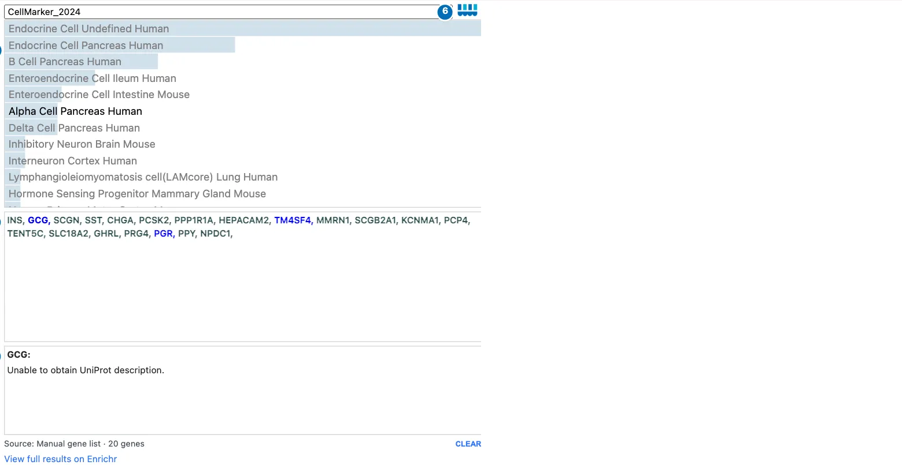
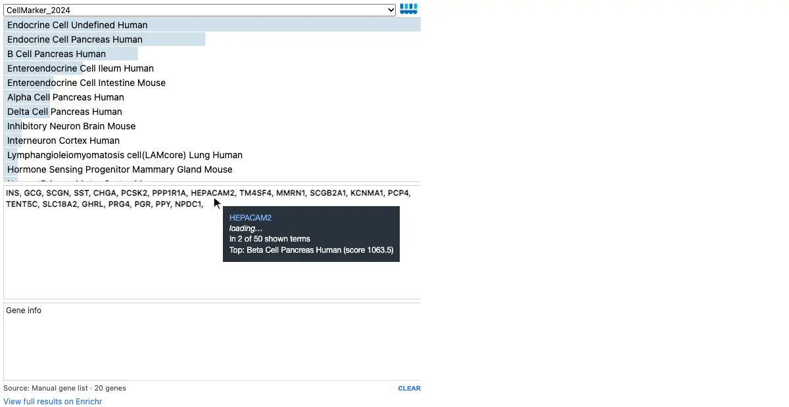

# Enrich

`Enrich` interprets a list of genes, such as the marker genes of a cluster, by
looking them up in public gene-set libraries through
[Enrichr](https://maayanlab.cloud/Enrichr/). It answers questions such as
"which cell types or biological processes are associated with these genes?"

## Reading Enrich

Enrich shows the top-ranked gene sets, or **terms**, for the current gene list,
and the genes themselves.

[](../assets/img/visualizations/enrich/overview.webp)

*The top 20 marker genes of the pancreatic islet cluster, looked up in
CellMarker 2024. With the Alpha Cell Pancreas Human term selected, its genes are
highlighted in the gene list.*

| | Control | What it does |
| --- | --- | --- |
| 1 | Library | Choose the gene-set library to search, such as `CellMarker_2024` for cell types; the default list includes cell-type, pathway, and tissue libraries. |
| 2 | Terms | The top terms, ranked by Enrichr's combined score; the bar length shows the score. |
| 3 | Gene list | The genes being looked up. |
| 4 | Gene information | The name and description of a clicked gene, from UniProt. |
| 5 | Source, **CLEAR**, and Enrichr link | Where the genes came from, a button to clear them, and a link to the full results on the Enrichr website. |
| 6 | Celldega logo | Opens this page. |

## Interacting with terms and genes

- **Hover a term** for its full name, combined score, p-value, adjusted
  p-value, odds ratio, and overlap with your gene list.
- **Click a term** to highlight its genes in the gene list; the other terms are
  dimmed. In a linked Clustergram, the term's genes turn blue. Click the term
  again to clear it.
- **Hover a gene** for its UniProt description and how many of the shown terms
  include it.
- **Click a gene** to bold it and show its description below the list. In
  linked views, the Clustergram zooms to the gene and a Landscape colors cells by
  it. Click it again to clear the focus.
- **CLEAR** empties the gene list.
- **Choose a library** to look up the same genes in another library.

[{ width="640" loading=lazy }](../assets/img/visualizations/enrich/terms_and_genes.webp)

*Hovering a term shows its statistics; selecting the delta and alpha cell terms
highlights their genes, such as SST and GCG; clicking GCG shows its
description.*

Enrich queries Enrichr from your browser, so it needs an internet connection.
Gene descriptions come from UniProt and are available for human gene symbols.

## Where the genes come from

Set the gene list from Python, or link Enrich to a
[Clustergram](clustergram.md) so that selections there update it:

| In the Clustergram | Genes sent to Enrich |
| --- | --- |
| Click a column label | That column's top marker genes |
| Click a row dendrogram branch | The branch's genes |
| Crop rows | The cropped genes |
| Click a column dendrogram branch | Its top marker genes, when `col_enrich=True` |

Clicking a single gene in the Clustergram focuses it without replacing the
enrichment gene list. See
[Landscape–Clustergram–Enrich](landscape-clustergram-enrich.md) for a linked
example.

## Widget: Python-backed interactions

As a notebook widget, Enrich shares its state with Python:

- `enrich.gene_list` sets or reads the genes, and `enrich.background_list` an
  optional background.
- `enrich.inst_lib` is the selected library.
- `enrich.selected_term` and `enrich.term_genes` hold the selected term and its
  genes.
- `enrich.focused_gene` is the clicked gene.

The links to a Clustergram run in the browser, so they keep working in a
[notebook report](index.md#two-ways-to-use-a-visualization).

## Usage

```python
import celldega as dega

enrich = dega.viz.Enrich(width=650, height=650)
enrich.gene_list = ["INS", "GCG", "SST", "CHGA", "PCSK2"]
enrich
```

Link it to a Clustergram with `dega.viz.clustergram_enrich(cgm)`, or to a
Landscape and Clustergram with
`dega.viz.spatial_clustergram(landscape, cgm, enrich=True)`. For the full list of
constructor arguments, see the [Viz Module API reference](../python/viz/api.md).

## Examples

The [Visium HD tutorial](../examples/tutorial_notebooks/Visium_HD_Human_CRC_Landscape-Clustergram-Enrich.ipynb)
and [Chromium PBMC tutorial](../examples/tutorial_notebooks/Scanpy_Chromium.ipynb)
connect Enrich to a Clustergram and Landscape.

## Screenshot sources

The screenshot and animation show the top 20 Scanpy marker genes of the islet
cluster in the [hosted Xenium pancreas AnnData](https://huggingface.co/datasets/broadinstitute/Celldega_Supporting_Data/blob/main/Xenium_V1_human_Pancreas_FFPE_outs.h5ad),
captured with Celldega 0.28.0 using
[`scripts/docs_screenshots/capture.py`](https://github.com/broadinstitute/celldega/tree/main/scripts/docs_screenshots).
