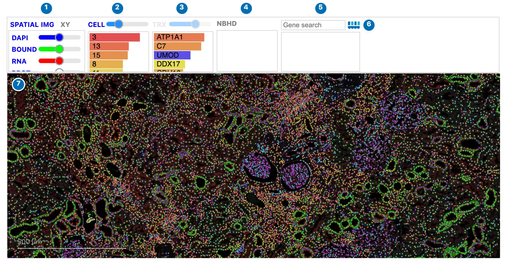

# Visualizations

Celldega's interactive views help you explore where cells are, how gene
expression varies, and which biological processes distinguish a group.
Use linked views to move between tissue context, expression patterns, and
gene-set interpretation.

For desktop viewing, try [Celldega-App](../getting-started/desktop-app.md),
with linked Landscape–Clustergram panels, Yearbook cell portraits, and saved
Clustergrams. [Download the latest build](https://github.com/broadinstitute/celldega-app/releases/latest)
or see the [desktop guide and screenshots](../getting-started/desktop-app.md).

## Video tutorial

This narrated walkthrough links a Landscape, Clustergram, and Enrich to explore
a Visium HD human colorectal cancer dataset. Follow along in the
[Visium HD Human CRC Landscape-Clustergram-Enrich](../examples/tutorial_notebooks/Visium_HD_Human_CRC_Landscape-Clustergram-Enrich.ipynb)
notebook.

<div style="position: relative; padding-bottom: 56.25%; height: 0; overflow: hidden; max-width: 100%;">
    <iframe src="https://www.youtube.com/embed/IjGsIykVIUE" title="Landscape, Clustergram, and Enrich tutorial in Celldega" loading="lazy" style="position: absolute; top: 0; left: 0; width: 100%; height: 100%; border: 0;" allowfullscreen></iframe>
</div>

## Spatial visualizations {#spatial}

Explore cells and neighborhoods in **physical space** (x/y, and sometimes z)
across a tissue section, or compare cells in a low dimensional embedding
landscape (UMAP/XY).

- **[Landscape](landscape/index.md)**: Where are cell types in the tissue, and
  which cells express a gene? Explore cells, transcripts, images, and
  neighborhoods over tissue, or switch to UMAP and gene-expression XY views.
- **[Yearbook](yearbook.md)**: What do individual cells look like? Compare a
  grid of cell portraits, each centered on one cell from the same spatial
  dataset, and mark cells for review.
- **[CellCloud](cell-cloud.md)**: How are cells arranged in 3D? Explore thick
  tissue and aligned serial sections.
- **[NeighborhoodCloud](neighborhood-cloud.md)**: How do tissue neighborhoods
  extend across slices? Explore neighborhoods and their cells in 3D.

## Data visualizations {#data}

Compare measured values across cells, clusters, neighborhoods, or samples.

- **[Clustergram](clustergram.md)**: Which genes distinguish each cell group,
  and which groups are most alike? Find expression patterns in a clustered
  heatmap or dot plot, with dendrograms and gene/metadata labels.
- **[Composition](composition.md)**: How do cell-type proportions differ
  across samples, regions, or neighborhoods?

## Information visualization {#info}

Interpret the genes that distinguish a selected group.

- **[Enrich](enrich.md)**: Which biological processes or cell types are
  associated with a set of genes? Explore gene-set enrichment against public
  libraries through Enrichr.

## Linked Visualization

Connect views of the same dataset to explore cell positions, expression
patterns, and gene-set enrichment together.

- **[Landscape–Clustergram–Enrich](landscape-clustergram-enrich.md)**: connect
  tissue or embedding views with expression patterns and gene-set interpretation.
- **[CellCloud–Clustergram](cell-cloud-clustergram.md)**: connect cells in 3D
  with expression patterns across cell groups.

Start with the [Gallery](../gallery/index.md) for interactive examples or the
[Example Notebooks](../examples/index.md) for complete workflows. Each
visualization's guide explains what it shows and how to create it; the
[Python API reference](../python/viz/api.md) covers constructor options and
notebook controls.

## The control panel

Landscape, Yearbook, CellCloud, and NeighborhoodCloud share a control panel above
the view. Clustergram, Composition, and Enrich have their own panels, described on
their pages.

[](../assets/img/visualizations/index/control_panel.webp)

*The Landscape control panel over a whole-transcriptome kidney section, showing
glomeruli and tubules. Cells are colored by cluster over the DAPI, boundary, and
RNA image channels.*

| | Control | What it does |
| --- | --- | --- |
| 1 | View and image | **SPATIAL**, **UMAP**, and **XY** switch between tissue, embedding, and two-gene views (UMAP appears when the data include an embedding). **IMG** shows or hides the image; each channel button toggles that channel, and its slider sets the channel's brightness. |
| 2 | **CELL** | Shows or hides the cells; the slider sets their size. The bars rank cell clusters by count: click a bar to select that cluster, and shift-click to add more. |
| 3 | **TRX** | Transcripts and gene expression. Zoomed in, TRX shows or hides individual transcripts and the slider sets their size; zoomed out, the slider sets how strongly cells are colored by a selected gene. The bars rank genes: click one to color cells by its expression. |
| 4 | **NBHD** | Neighborhoods: shows supplied tissue regions, or lets you draw your own. Appears only when neighborhoods are supplied or drawing is turned on. |
| 5 | Gene search | Type one or more gene names, separated by commas, to color cells by expression; clear the box to return to cluster colors. The box below describes the selected gene, from UniProt. |
| 6 | Celldega logo | Opens this visualization's documentation page. **PIC**, next to it, saves a [screenshot with a description](#screenshots). |
| 7 | The view | Scroll to zoom, drag to pan, hover over cells and transcripts for details, and click a cell to select its cluster. |

Conventions shared across visualizations:

- **Blue** button text means on; **gray** means off. A faded button is not
  available at the current zoom.
- Scrolling over a Landscape, CellCloud, or Clustergram zooms it instead of
  scrolling the page. Move the pointer off the visualization to scroll the page.
- Hovering shows details in a tooltip, without changing the selection;
  clicking selects. For genes, hovering shows a brief UniProt description and
  clicking shows it in the gene information box.
- The **Celldega logo** in every control panel links to that visualization's
  page in this documentation.

## Two ways to use a visualization

Each visualization, such as a Landscape or a Clustergram, runs in your web
browser. You can use it in two ways:

```text
 Notebook widget (Jupyter or marimo)      JavaScript on a web page
┌────────────────────────────────────┐   ┌────────────────────────────────────┐
│ Python kernel                      │   │ Gallery, standalone web page,      │
│   AnnData, Matrix, your analysis   │   │ or notebook report (no Python)     │
│     │ options        ▲ selections, │   │                                    │
│     ▼ and data       │ drawings    │   │                                    │
│ Browser                            │   │ Browser                            │
│   Landscape ◄─link─► Clustergram   │   │   Landscape ◄─link─► Clustergram   │
└────────────────────────────────────┘   └────────────────────────────────────┘
                   ▲                                        ▲
                   └───────────────────┬────────────────────┘
                                       │
           prepared data (DegaFiles or AnnData Zarr), read over HTTP
```

- **As a notebook widget with a Python back-end.** Create the visualization
  from your analysis in Jupyter or [marimo](https://marimo.io/). The Python
  back-end makes the widget stateful: selections, drawn neighborhoods, and
  annotations are available to your analysis, and Python can update the view.
  Links between widgets, such as a Clustergram click coloring a Landscape, run in
  the browser through the widget framework (`jslink`).

  You can also embed visualizations in notebook **reports**: static HTML pages
  made from pre-executed notebooks saved with their widget state. The
  visualizations and their links stay interactive in the report, without a
  running kernel. The [Example Notebooks](../examples/index.md) on this site are
  shown this way.
- **As JavaScript on a web page, without Python.** The [Gallery](../gallery/index.md)
  pages, standalone pages built with the [JavaScript API](../javascript/index.md),
  and notebook reports all run the same visualizations in the browser. Every
  interaction and browser link works; there is no Python back-end to receive
  selections or annotations.

Each visualization's page describes its interactions, which are the same in
both cases, and then what the widget's Python back-end adds.

## Reading and driving visualizations from code

Every visualization can be read and changed from code as well as by clicking: getters
report what it shows, setters change it as its controls would, and exporters capture it
as an image. The same keys work in Python (`widget.request_state()`,
`widget.apply_state()`, `widget.screenshot()`) and JavaScript; see the
[Viz API](../javascript/viz-api.md).

## Screenshots with provenance {#screenshots}

The goal is to **preserve an interactive observation as reproducible visual evidence**.
A screenshot is the image export; its saved-view record preserves the scientific
context and supported replay settings.
Celldega saves a PNG and a human-readable Markdown companion:

- `<name>.png`: the image, with your description, who made it and when, the Celldega version, each
  widget's saved view (`snapshot`, with its replay settings in `snapshot.state`), its
  observed state (`observed_state`), what was in view (cell counts per cluster, top
  genes), and the data it came from (dataset name, base URL or AnnData Zarr URL,
  AnnData shape, the Matrix's source) embedded in its metadata;
- `<name>.md`: the description, the image, provenance and code to reopen the view.

The PNG is sufficient to carry the saved view; no JSON sidecar is written, and the
Markdown companion is not needed for replay.

The saved view records what data it shows (cell, gene and cluster names, or a
Clustergram's row and column names). Image and state are captured together.
`widget.restore_snapshot(...)` checks the schema, data identity and canvas size
before changing the view; see [portable saved views](../javascript/saved-views.md)
for reopening exports and declaring an exact data revision.

Records are marked `restoration: "partial"`. They preserve the image and provenance,
and `from_png` can load a recorded source into a fresh widget, but not every control
is restored. See
[replay coverage and limitations](../javascript/viz-api.md#replaying-supported-settings).

Save one from a widget's control panel with **PIC**: it captures the view, then asks
for a title and a description of what you're looking at and why it's interesting. Or
from Python, on a Landscape, Clustergram, CellCloud or NeighborhoodCloud. In a web
page without a notebook kernel, PIC downloads a PNG with the replay state and
description embedded:

```python
landscape.screenshot(
    description="Podocyte-like cells ring each glomerulus; the ring breaks where ...",
    path="figures/",            # a folder, or a file like "figures/fig2a.png"
)
# A linked row (or several widgets) becomes one image, side by side:
dega.viz.screenshot(linked, description="...", path="figures/fig2.png")
```

The image arrives from the browser after the cell finishes, so the call's output shows
"Capturing…" and then a preview with the saved path. Without a path, screenshots go to
`celldega_files/screenshots/` (or `widget.screenshot_dir`). This export directory can be
kept out of version control or shared as a collection of evidence.

The PNG records links, not data: a widget's `base_url` or `zarr_url`, and a Matrix's
Zarr source when it was opened with `Matrix.read_zarr`, plus constructor options. An
object passed in memory, such as `adata=adata` or a Matrix built in the notebook, has
no path to record (`read_h5ad` keeps none). The PNG stores its shape and marks it as
needed again when reopening. The whole record is typically a few KB.

Record what Python can't see, such as the AnnData file a widget was made from, once per
widget; it's added to every screenshot of it, including PIC ones. This is a note for
readers: reopening still needs the object passed back.

```python
landscape.screenshot_metadata = {"adata": "data/kidney.h5ad", "notebook": "review.ipynb"}
```

Reopen the image as an interactive visualization:

```python
view = dega.viz.from_png("figures/fig2a.png")
display(view)
# In a later cell: None while pending, else applied/apply_error.
view.get_apply_result(view.apply_request_id)
```

The original data must still be available. Supply `matrix=mat` or `adata=adata`
when the original view used an in-memory object; constructor options can point to
a relocated source. For a composite screenshot, `panel=1` opens the second widget.
Use `widget.restore_png(path)` to restore into a widget that already has its data.
See [portable saved views](../javascript/saved-views.md#reopen-a-png-as-an-interactive-visualization)
for browser usage, validation and restoration limits.

Inspect the embedded record with `dega.viz.load_screenshot(path)` and discover a
folder's PNG records with `dega.viz.load_screenshots(folder)`. A folder of screenshots
works as a scrapbook of what you found along the way, reusable by people and
application agents.
