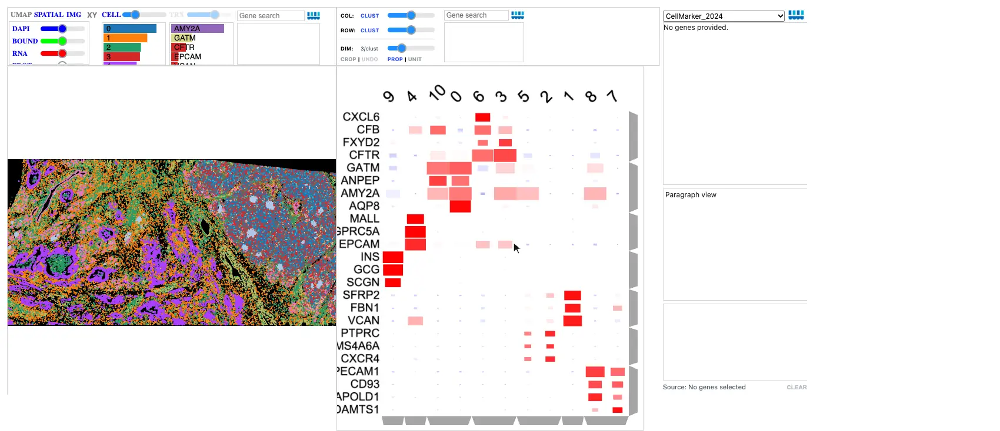
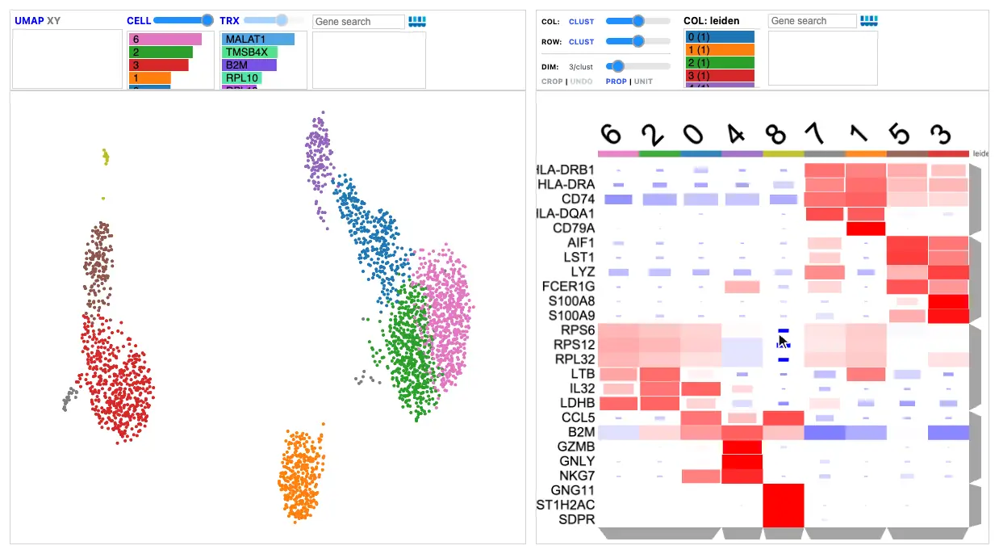

# Landscape–Clustergram–Enrich

Link a [Landscape](landscape/index.md), [Clustergram](clustergram.md), and
[Enrich](enrich.md) to move between where cells are, which genes distinguish
them, and what those genes mean. The Landscape shows the cells, in tissue or in
a UMAP; the Clustergram organizes expression across genes and cell groups; and
Enrich interprets a selected group of genes through gene-set enrichment.

## How the views connect

| In the Clustergram | Landscape | Enrich |
| --- | --- | --- |
| Click a gene label | Colors cells by that gene; click again to return to clusters | — |
| Click a column label | Shows that group's cells | Receives the group's top marker genes |
| Click a row dendrogram branch | Colors cells by the genes' combined expression | Receives the branch's genes |
| Click a mark | Colors cells by that gene within that group | — |

| In Enrich | Clustergram | Landscape |
| --- | --- | --- |
| Click a term | Its genes' labels turn blue | — |
| Click a gene | Zooms to the gene | Colors cells by the gene |

Selections made in the Landscape do not change the other views. The links run
in the browser, so they keep working in a published
[notebook report](index.md#two-ways-to-use-a-visualization).

## Spatial data

For spatial data, the Landscape shows the tissue from DegaFiles, with your
clusters from an AnnData.

[{ loading=lazy }](../assets/img/visualizations/landscape-clustergram-enrich/spatial.webp)

*Xenium pancreas: clicking INS colors the islets in the tissue; clicking the islet
cluster (9) shows its cells and sends its markers to Enrich; clicking the
INS–GCG–SCGN branch sends those genes to Enrich and colors cells by their
combined expression; and clicking a term turns its genes blue in the
Clustergram.*

```python
import scanpy as sc
import celldega as dega

sc.tl.rank_genes_groups(adata, groupby="leiden")
markers = dega.clust.Matrix(adata, groupby="leiden")
markers.filter_by_size(0.05)
markers.norm("row", by="zscore")
markers.cluster(view="rank_genes_groups", levels=[1, 3, 5, 10])

landscape = dega.viz.Landscape(
    base_url="https://your-data-host/DegaFiles",
    adata=adata,
    cluster_attr="leiden",
)
cgm = dega.viz.Clustergram(matrix=markers, rank_dim=3)

dega.viz.spatial_clustergram(landscape, cgm, enrich=True)
```

The AnnData's `obs_names` must match the DegaFiles' cell IDs, and the Matrix's
`groupby` must be the Landscape's `cluster_attr`. Color is each group's mean
expression, z-scored across groups; dot size is the fraction of the group's
cells that express the gene. [Visualize Your Own Data](../getting-started/your-data.md)
walks through this example from the instrument output.

## Single-cell data

For single-cell data, the Landscape shows the UMAP from an AnnData Zarr store,
read directly in the browser, with no DegaFiles. The linked Clustergram adds a
higher-dimensional view: which genes distinguish the clusters you see in the
UMAP.

[{ loading=lazy }](../assets/img/visualizations/landscape-clustergram-enrich/single_cell.webp)

*PBMC 3k: clicking cluster 1 shows its cells in the UMAP; clicking the B-cell
gene CD79A colors those cells; clicking the monocyte gene LYZ colors the
monocytes.*

```python
adata.layers["counts_csc"] = adata.layers["counts"].tocsc()
adata.write_zarr("cells.zarr")

landscape = dega.viz.Landscape(
    zarr_url="cells.zarr", zarr_layer="counts_csc", cluster_attr="leiden"
)
cgm = dega.viz.Clustergram(matrix=markers, rank_dim=3)  # markers as above
dega.viz.spatial_clustergram(landscape, cgm, enrich=True)
```

A Clustergram can also show individual cells instead of cluster summaries, for
example a single-cell Clustergram of a selected population; the
[Chromium PBMC tutorial](../examples/tutorial_notebooks/Scanpy_Chromium.ipynb)
links both kinds to UMAP Landscapes.

## Try the linked selections

1. **Click a gene in the Clustergram.** The Landscape colors cells by that
   gene's expression, in tissue or the UMAP.
2. **Select a cell group in the Clustergram.** The Landscape shows those cells,
   and Enrich receives the group's top marker genes.
3. **Select a gene group with the row dendrogram.** Enrich looks up the genes
   in the selected library.
4. **Select an enriched term.** Its genes are highlighted in the Clustergram.
5. **Click a gene in Enrich.** The Clustergram zooms to that gene and the
   Landscape colors cells by its expression.

A focused gene and the enrichment gene set are kept separate: inspecting one
gene does not replace the multi-gene enrichment query.

## Examples and reference

- [Visium HD tutorial](../examples/tutorial_notebooks/Visium_HD_Human_CRC_Landscape-Clustergram-Enrich.ipynb):
  a complete spatial Landscape–Clustergram–Enrich workflow.
- [Narrated walkthrough](index.md#video-tutorial): watch the linked spatial
  workflow.
- [Chromium PBMC tutorial](../examples/tutorial_notebooks/Scanpy_Chromium.ipynb)
  and [Tabula Sapiens tutorial](../examples/tutorial_notebooks/Tabula_Sapiens_Landscape-Clustergram-Enrich.ipynb):
  single-cell UMAP Landscapes linked to Clustergrams and Enrich.
- [Python linking API](../python/viz/api.md#celldega.viz.spatial_clustergram):
  layout and enrichment options.
- [CellCloud–Clustergram](cell-cloud-clustergram.md): the same linking for
  cells in 3D.

Source: [linking helpers](https://github.com/broadinstitute/celldega/blob/main/src/celldega/viz/__init__.py).

## Screenshot sources

The animations show the Xenium pancreas DegaFiles with the
[hosted Scanpy AnnData](https://huggingface.co/datasets/broadinstitute/Celldega_Supporting_Data/blob/main/Xenium_V1_human_Pancreas_FFPE_outs.h5ad),
and the PBMC 3k AnnData Zarr and marker Matrix from the
[Chromium PBMC tutorial](../examples/tutorial_notebooks/Scanpy_Chromium.ipynb),
captured with Celldega 0.28.0 using
[`scripts/docs_screenshots/capture.py`](https://github.com/broadinstitute/celldega/tree/main/scripts/docs_screenshots).
