# Landscape

`Landscape` shows where cells are and what they express. In spatial data, it
draws tissue images, cells, transcripts, and neighborhoods together, so you can
ask where a cell type sits in the tissue, which cells express a gene, and which
cells neighbor each other. The same cells can also be shown in a
low dimensional embedding, such as a UMAP.

Spatial Landscapes read [DegaFiles](../../getting-started/file_formats.md#degafiles),
loading the image, cell, and transcript tiles needed for the current view. This
page covers the spatial view. [UMAP and XY](umap-xy.md) covers embeddings and
single-cell data, and [Neighborhoods](neighborhoods.md) covers drawing and
using tissue regions and gates.

<div class="viz-preview">
  <p class="viz-preview-status" role="status">Loading an interactive preview…</p>
  <div id="preview-landscape"></div>
</div>

*Interactive preview: an Atera whole-transcriptome kidney section. Scroll to zoom
into glomeruli, tubules, and individual transcripts; drag to pan; and click a
cluster or gene. Open a [larger view](../../gallery/gallery_atera_kidney.md) in the
Gallery.*

## Reading a Landscape

Close up, a Landscape layers the microscopy image, each cell's segmentation
boundary and centroid, and every detected transcript. Cells are colored by
cluster, and transcripts by gene. The bar graphs in the control panel summarize
what is in view: the **CELL** bars count cells per cluster, and the **TRX** bars
count transcripts per gene.

[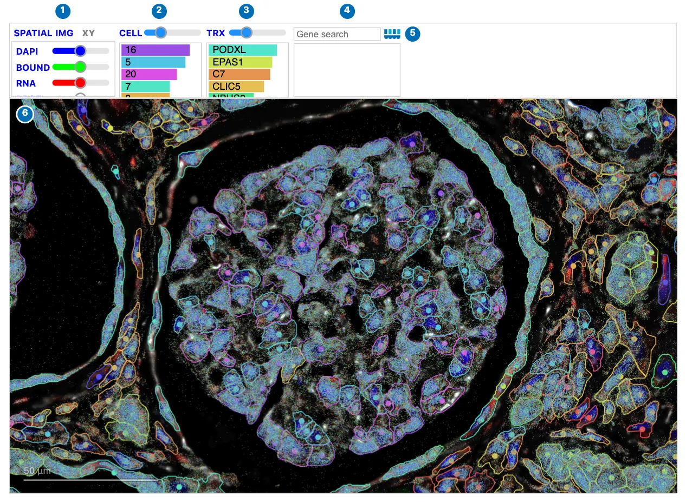](../../assets/img/visualizations/landscape/overview.webp)

*A glomerulus in a whole-transcriptome kidney section. Podocytes (cluster 16)
lead the CELL bars and the podocyte gene PODXL leads the TRX bars, because they
are what is in view.*

| | Control | What it does |
| --- | --- | --- |
| 1 | View and image | **SPATIAL**, **UMAP**, and **XY** switch views; **IMG** shows or hides the image; each channel button toggles a channel, and its slider sets the channel's brightness. |
| 2 | **CELL** | Shows or hides cells; the slider sets their size. The bars rank clusters by the number of cells in view. |
| 3 | **TRX** | Transcripts and gene expression. Its button and slider depend on the zoom; see [Genes and transcripts](#genes-and-transcripts). The bars rank genes. |
| 4 | Gene search | Color cells by one or more genes. The box below describes the selected gene. |
| 5 | Celldega logo | Opens this page. |
| 6 | The view | Scroll to zoom, drag to pan, hover for details, and click to select. |

The control panel is shared with Yearbook, CellCloud, and NeighborhoodCloud; see
[the control panel](../index.md#the-control-panel).

## Zooming and panning

Scroll to zoom and drag to pan. A Landscape uses **semantic zoom**: what it
draws, and what its controls do, change with the zoom level.

- **Zoomed out**, each cell is a dot colored by cluster or gene expression, over
  the whole tissue.
- **Closer in**, the image appears at higher resolution, and **TRX** can load the
  transcripts and cell boundaries in view on request.
- **Close up**, transcripts and cell boundaries load automatically for the tiles
  in view.

Because a Landscape only loads the tiles in view, it stays responsive even for
datasets with over a billion transcripts. See
[Performance](../../getting-started/index.md#performance).

[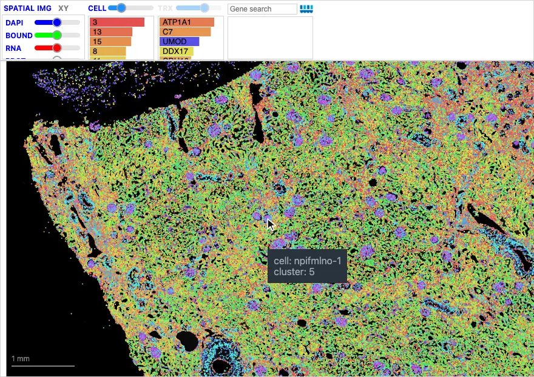{ width="880" loading=lazy }](../../assets/img/visualizations/landscape/zoom.webp)

*Scrolling into a glomerulus: cell boundaries and transcripts load as the view
narrows, and the TRX button becomes active.*

Double-clicking does not zoom. The zoom stops slightly beyond the whole tissue
and at about 10 µm across the view; `min_zoom` and `max_zoom` change these
limits.

## Images

**IMG** shows or hides the image. Each channel, such as DAPI or a membrane
stain, has a button to show or hide it and a slider for its brightness. When an
aligned H&E image has been added to the DegaFiles, an **FLR / H&E** selector
next to **IMG** switches between the fluorescence channels and H&E; see
[Add aligned H&E to DegaFiles](../../python/aligned_he.md).

[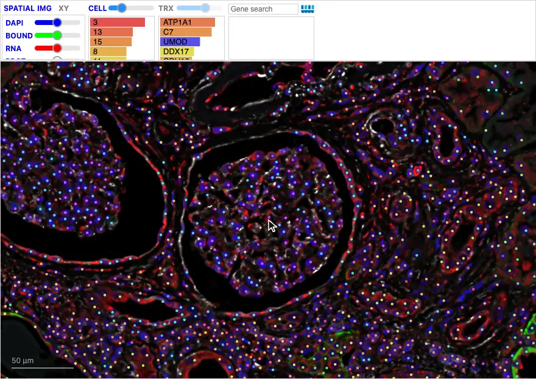{ width="880" loading=lazy }](../../assets/img/visualizations/landscape/image_channels.webp)

*Hiding the cells, turning off the boundary and RNA channels, adjusting DAPI
brightness, and restoring them.*

When you select a cluster or gene while zoomed out, the image is hidden so that
the selected cells stand out. It returns when you zoom in close or clear the
selection.

## Cells and clusters

**CELL** shows or hides the cells, and its slider sets their size. Click a
cluster's bar to show only that cluster; click it again to show all clusters.
**Shift-click** more bars to add clusters to the selection. Hover a bar for its
cell count. You can also click a cell in the view to select its cluster.

[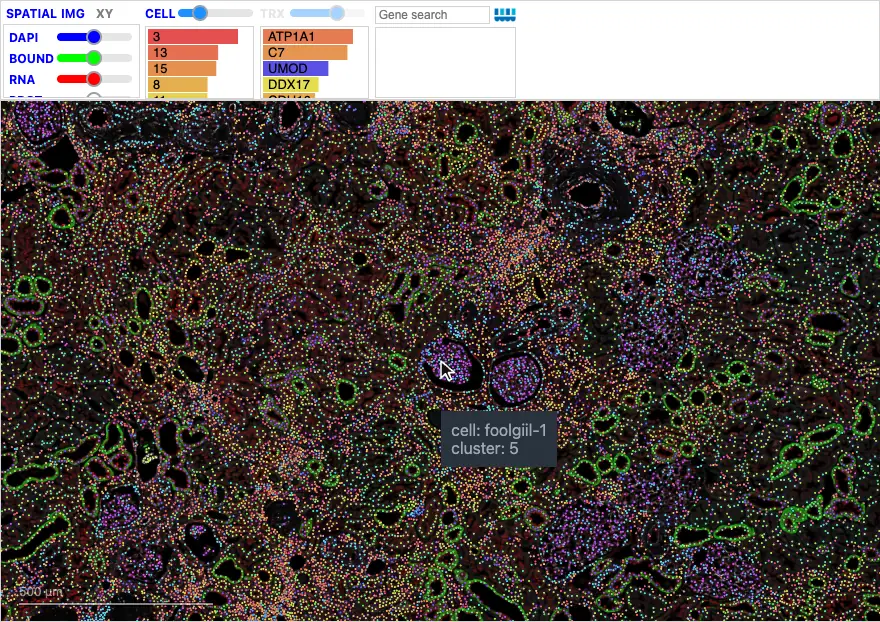{ width="880" loading=lazy }](../../assets/img/visualizations/landscape/select_clusters.webp)

*Selecting podocytes (cluster 16) outlines every glomerulus in the section;
shift-clicking adds glomerular endothelial cells (cluster 20).*

Selecting a cluster clears any gene selection.

## Genes and transcripts

Click a gene's bar, or type its name in the gene search box, to color cells by
its expression. Type several names separated by commas, or **shift-click**
several bars, to color cells by their **combined** (summed) expression; up to the
20 highest-expressed genes are combined. Clear the search box, or type
`cluster`, to return to cluster colors.

[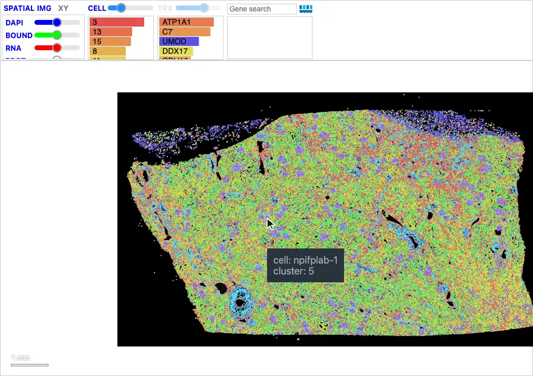{ width="880" loading=lazy }](../../assets/img/visualizations/landscape/search_genes.webp)

*Searching for the podocyte marker NPHS2 and the endothelial marker EMCN lights
up every glomerulus across the section; zooming into one shows the two genes'
individual transcripts.*

### The TRX controls change with the zoom

The **TRX** button and slider are an example of semantic zoom:

| Zoom | TRX button | TRX slider |
| --- | --- | --- |
| Close up | Blue or gray: shows or hides transcripts, which load automatically | Transcript size |
| Closer in | Gray: click to load the transcripts and boundaries in view | Cell expression opacity, once a gene is selected |
| Zoomed out | Faded: transcripts are not available | Cell expression opacity, once a gene is selected |

Zoomed out, a selected gene colors cells, and the slider sets how strongly; the
gene box shows the expression that reaches full color, such as
`Full opacity at ≥ 145`. Close up, the same selection shows only those genes'
transcripts, each colored by gene, and the slider sets their size.

[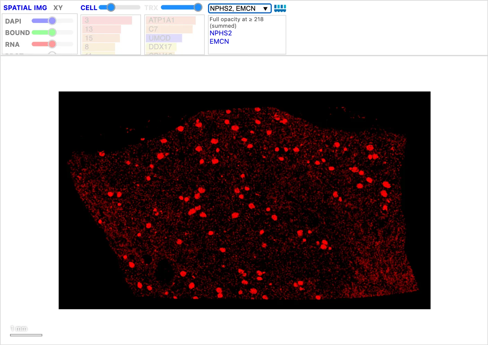{ width="880" loading=lazy }](../../assets/img/visualizations/landscape/genes_zoomed_out.webp)

*Zoomed out: cells colored by the combined expression of NPHS2 and EMCN. Every
glomerulus stands out; the fainter signal elsewhere fits EMCN in endothelial
cells outside the glomeruli.*

[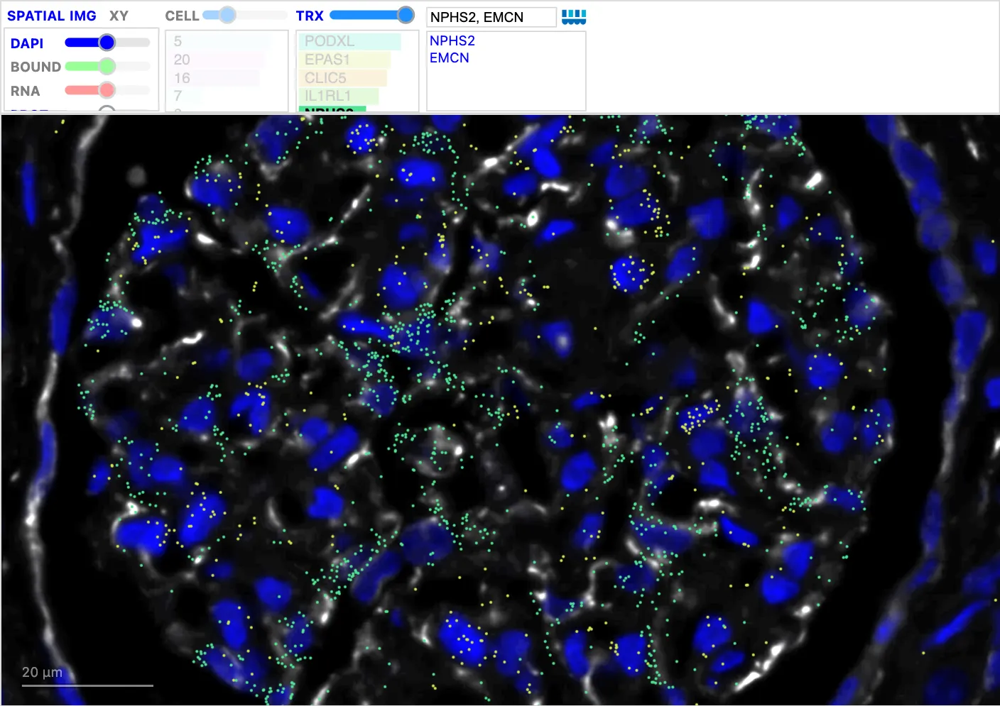{ width="880" loading=lazy }](../../assets/img/visualizations/landscape/genes_zoomed_in.webp)

*Close up, with cells hidden: NPHS2 transcripts (teal) along the podocytes and
EMCN transcripts (yellow) in the capillaries, two orthogonal markers in one
glomerulus.*

The gene box describes the selected genes using [UniProt](https://www.uniprot.org/)
(human gene symbols). Clicking a transcript selects its gene.

### Sequencing-based spatial data

Sequencing-based technologies such as Visium HD measure expression in a grid of
small bins rather than as individual transcripts. To show this as transcripts,
preprocessing creates one point per count in each bin and adds a small random
offset, or **jitter**, so that a bin's points spread out instead of drawing on
top of each other. Zoomed in, each bin then shows the mix of genes it detected,
in their gene colors, and the same gene controls work as for imaging data. The
positions within a bin are a visual aid, not measured locations.

[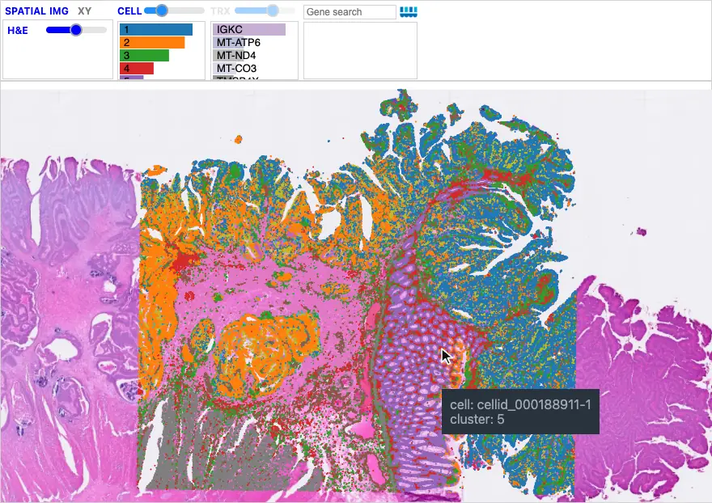{ width="880" loading=lazy }](../../assets/img/visualizations/landscape/visium_hd.webp)

*Visium HD colorectal cancer: zooming from the whole section into normal crypts
reveals jittered transcripts, and the TRX bars are led by plasma-cell genes
(IGKC, PIGR, JCHAIN). Selecting IGKC and hiding the H&E shows its transcripts in
the plasma cells around the crypts; zooming out shows IGKC across the section.*

Celldega's preprocessing writes these points with
`pre.write_pseudotranscripts_from_sbg`, whose `jitter` argument sets the range of
the offset; see the [pre API](../../python/pre/api.md). The
[Visium HD colorectal cancer tutorial](../../examples/tutorial_notebooks/Visium_HD_Human_CRC_Landscape-Clustergram-Enrich.ipynb)
explores this dataset with a linked Clustergram and Enrich.

## Spaces and embeddings

The same cells can be shown in more than one **space**: their positions in the
tissue, and a low dimensional **embedding**, such as a UMAP computed from their
expression. Pass an AnnData with `obsm["X_umap"]`, for example from Scanpy, along
with the DegaFiles, and **UMAP** and **SPATIAL** move the cells between the two
spaces. The move is animated so that you can follow the cells. Select a cluster
in one space, then switch to the other to see where those cells are.

[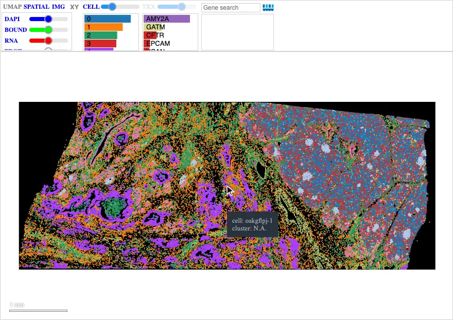{ width="880" loading=lazy }](../../assets/img/visualizations/landscape/spaces.webp)

*Xenium pancreas: zoomed out on the tissue, the cells move into their Scanpy
UMAP. Selecting the islet cluster (9) highlights it in the UMAP, and switching
back to **SPATIAL** shows the islets in the tissue.*

In both spaces, the bar graphs describe the cells in view, so zooming into a
region is a way to **query its neighborhood**: a tissue region in the spatial
view, or a group of similar cells in the UMAP.

The [Scanpy–Squidpy Xenium pancreas tutorial](../../examples/tutorial_notebooks/Scanpy-Squidpy_Xenium_Pancreas.ipynb)
computes this UMAP with Scanpy and passes it to the Landscape. The AnnData's cell
IDs must match the DegaFiles:

```python
adata.obs_names = adata.obs["cell_id"].astype(str)  # Xenium cell IDs
landscape = dega.viz.Landscape(base_url=base_url, adata=adata, cluster_attr="leiden")
```

See [UMAP and XY](umap-xy.md) for more about embeddings.

## Hovering for details

Hover over a cell for its ID and cluster, and its expression when cells are
colored by a gene. Hover over a transcript for its gene, with the protein name
and description from UniProt.

[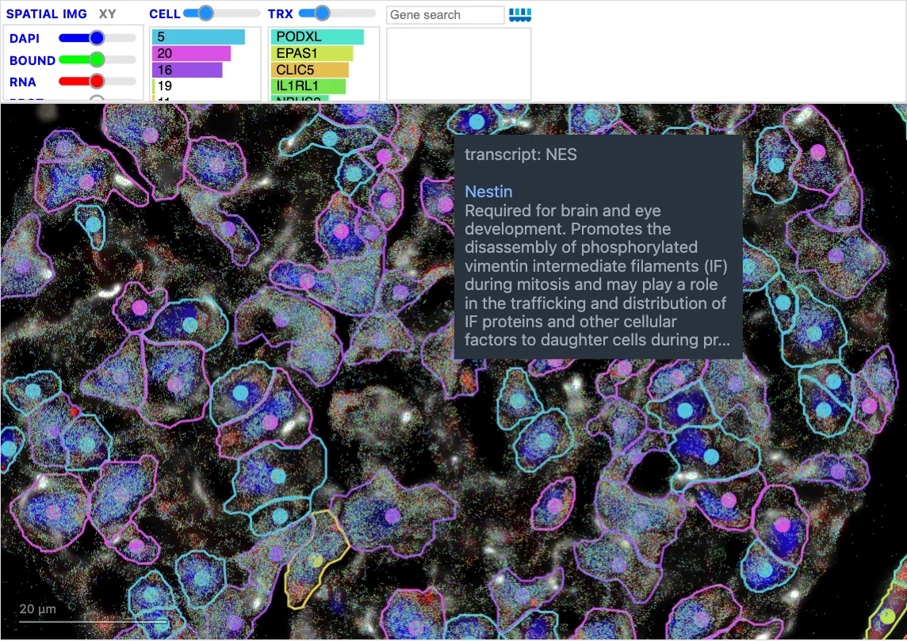{ width="880" loading=lazy }](../../assets/img/visualizations/landscape/transcript_tooltip.webp)

*Hovering a transcript shows its gene, here NES (Nestin), with a description.*

## Single-cell Landscapes

For single-cell RNA-seq, a Landscape needs no DegaFiles. Save your Scanpy
AnnData as an AnnData Zarr store with a CSC copy of the expression matrix, and
the browser reads the cells, their UMAP, and one gene at a time directly from the
store. Add a Clustergram of cell-type marker genes for a linked
Landscape–Clustergram. Spatial data needs one more step, preparing DegaFiles for
the images, transcripts, and boundaries, but single-cell data goes straight from
an AnnData:

```python
import scanpy as sc
import celldega as dega

# Cells: a CSC copy lets the browser read one gene at a time.
adata.layers["counts_csc"] = adata.layers["counts"].tocsc()
adata.write_zarr("cells.zarr")

# Cell-type marker genes as a dot plot, clustered on both axes.
sc.tl.rank_genes_groups(adata, groupby="cell_type")
markers = dega.clust.Matrix(adata, groupby="cell_type")
markers.norm("row", by="zscore")
markers.cluster(view="rank_genes_groups", levels=[1, 3, 5, 10])

landscape = dega.viz.Landscape(
    zarr_url="cells.zarr", zarr_layer="counts_csc", cluster_attr="cell_type"
)
cgm = dega.viz.Clustergram(matrix=markers, rank_dim=3)
dega.viz.spatial_clustergram(landscape, cgm)
```

In a single-cell Landscape, the bars describe the cells in view. As you pan and
zoom, the **CELL** bars count the cells of each type in view, which gives the
local cell-type proportions. With cell-type signatures, the gene bars estimate the
mean expression of the cells in view from those proportions, and **TRX** turns
purple. See
[viewport estimates](umap-xy.md#viewport-cell-types-and-estimated-expression).

Zooming in therefore queries the **local neighborhood** you are looking at, in
data space here just as in tissue space for spatial data: which cell types are
in this part of the UMAP, and which genes characterize them. Click a gene from
those bars, then zoom out to see how localized its expression is.

[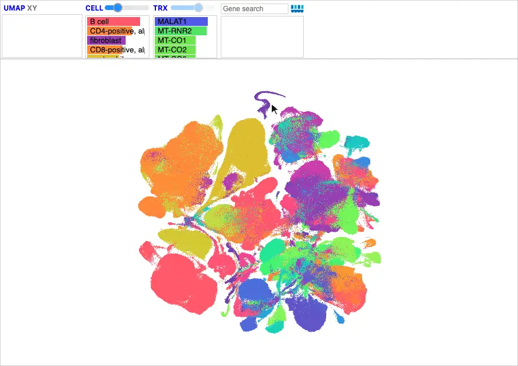{ width="880" loading=lazy }](../../assets/img/visualizations/landscape/single_cell.webp)

*Tabula Sapiens: zooming into the swirl of spermatids at the top of the UMAP,
the CELL bars narrow to spermatids and spermatocytes, and TRX turns purple.
Selecting the top estimated gene, RGMB-AS1, and zooming out shows its expression
concentrated in the swirl.*

Explore the 1.1-million-cell atlas with its linked marker
[Clustergram in the Gallery](../../gallery/gallery_tabula_sapiens_clustergram.md),
or follow the
[Tabula Sapiens notebook](../../examples/tutorial_notebooks/Tabula_Sapiens_Landscape-Clustergram-Enrich.ipynb)
to build the Landscape, Clustergram, and Enrich from AnnData Zarr stores. The
[Chromium PBMC tutorial](../../examples/tutorial_notebooks/Scanpy_Chromium.ipynb)
walks through the same steps from a Scanpy analysis.

## Multiple datasets

Pass a list of DegaFiles URLs to switch between datasets in one Landscape. A
dropdown after **IMG** lists them, and switching keeps the selected clusters,
genes, and view where possible:

```python
landscape = dega.viz.Landscape(
    base_url=["https://host/sample_a", "https://host/sample_b"],
    dataset_names=["Sample A", "Sample B"],
)
```

Each item can also be a dictionary with `url`, `label`, and `short_label`.

## Linking to other visualizations

Linked to a [Clustergram](../clustergram.md) with
[`dega.viz.spatial_clustergram`](../../python/viz/api.md), a Landscape responds to
Clustergram clicks: a gene colors cells by its expression, a cluster selects its
cells, and a gene group colors cells by the genes' combined expression. See the
Clustergram's [linking table](../clustergram.md#linking-to-other-visualizations).
Selections made in the Landscape do not change the Clustergram.

## Widget: Python-backed interactions

As a notebook widget, a Landscape also shares state with Python:

- **Selected cells**: `landscape.selected_cells` holds the cells of the selected
  clusters, a drawn neighborhood, or cells highlighted from a linked Clustergram.
  `landscape.get_selected_cells(adata)` returns them as an AnnData.
- **View**: `landscape.landscape_state` is `"spatial"`, `"umap"`, or `"xy"`.
- **Neighborhoods**: drawn regions are available as `landscape.nbhd`; see
  [Neighborhoods](neighborhoods.md).
- **Updates from Python**: `landscape.update_cell_clusters(...)` recolors cells
  with new cluster labels, and `landscape.highlight_cells(...)` highlights cells.

The zoom, pan, slider positions, and selected genes are not sent back to Python
automatically, but you can ask for them, and set them, from code:

```python
# Change what the Landscape shows, as its controls would.
landscape.apply_state({"clusters": ["4", "5"]})          # highlight clusters ([] clears)
landscape.apply_state({"genes": ["MUC2", "TFF3"]})        # color cells by genes ([] = clusters)
landscape.apply_state({"zoom_to": {"clusters": ["4"]}})  # frame a cluster (or {"cells": [...]})
landscape.apply_state({"view": {"target": [x, y], "zoom": 2}})
landscape.apply_state({"reset_view": True})
landscape.apply_state({"space": "umap"})

# Ask what it shows: space, camera, coloring, selection, and the cells per cluster
# and top genes in the current field of view. The reply arrives asynchronously, so
# read it in a later cell.
landscape.request_state()
landscape.latest_state

# Drawn neighborhoods with each one's cell count and cluster mix.
landscape.neighborhood_summary()
```

Layer toggles and sliders are not settable yet.

## Use it from Python

```python
import celldega as dega

landscape = dega.viz.Landscape(
    base_url="https://your-landscape-files-url",
    adata=adata,
    ini_zoom=-5,
)
landscape
```

The optional `adata` supplies cell attributes, cluster colors, and UMAP
coordinates; its `obs_names` must match the DegaFiles cell IDs. The segmentation
shown is chosen when the widget is created, with `segmentation=`.

To add an aligned H&E background to prepared DegaFiles, use
`dega.pre.add_aligned_he("data/DegaFiles", "sample_he.ome.tif",
alignment="sample_he_imagealignment.csv")`, then reload the Landscape. See
[Add aligned H&E to DegaFiles](../../python/aligned_he.md).

For constructor arguments and methods, see the
[Viz API](../../python/viz/api.md#landscape-data-sources-and-controls). For
web pages without Python, see the
[JavaScript API](../../javascript/api.md#visualizations-without-python-landscape-clustergram-and-link_models).

## Source code

- [Python Landscape widget](https://github.com/broadinstitute/celldega/blob/main/src/celldega/viz/widget.py):
  constructor, AnnData metadata, signatures, and selection/neighborhood methods.
- [Browser initialization](https://github.com/broadinstitute/celldega/blob/main/js/celldega.js)
  and [Landscape renderer](https://github.com/broadinstitute/celldega/blob/main/js/viz/landscape_ist.js).
- [Pseudo-transcripts for sequencing-based data](https://github.com/broadinstitute/celldega/blob/main/src/celldega/pre/sbg_tile.py).

## Screenshot sources

Screenshots and animations show the
[Atera whole-transcriptome kidney DegaFiles](https://github.com/broadinstitute/Celldega_Atera_v1_WTA_Kidney_non_diseased_FFPE)
from the [Atera kidney tutorial](../../examples/tutorial_notebooks/Atera_Kidney_Landscape-Clustergram.ipynb),
the Xenium pancreas DegaFiles and AnnData from the
[Scanpy–Squidpy pancreas tutorial](../../examples/tutorial_notebooks/Scanpy-Squidpy_Xenium_Pancreas.ipynb),
the Visium HD colorectal cancer DegaFiles from the
[Visium HD CRC tutorial](../../examples/tutorial_notebooks/Visium_HD_Human_CRC_Landscape-Clustergram-Enrich.ipynb), and the [Tabula Sapiens atlas](../../gallery/gallery_tabula_sapiens.md)
(Tabula Sapiens Consortium, via CZ CELLxGENE Discover, CC BY 4.0). They were captured with Celldega 0.28.0 using
[`scripts/docs_screenshots/capture.py`](https://github.com/broadinstitute/celldega/tree/main/scripts/docs_screenshots).
