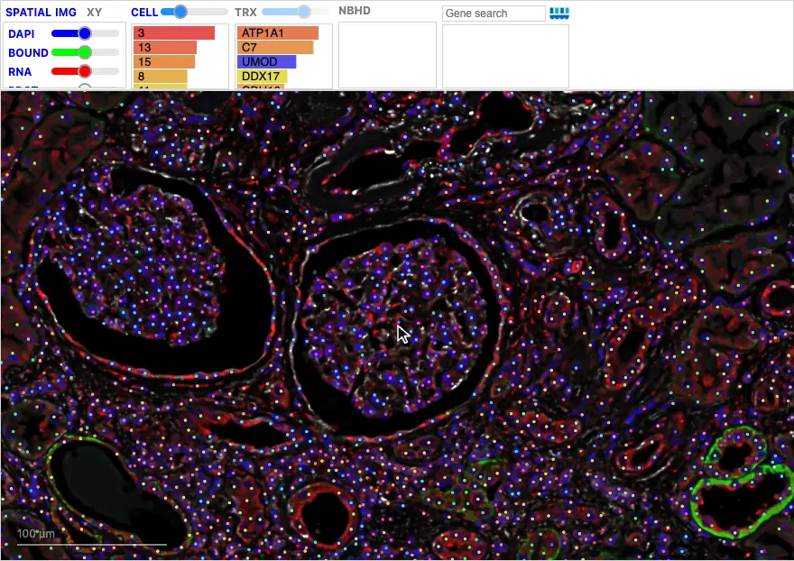
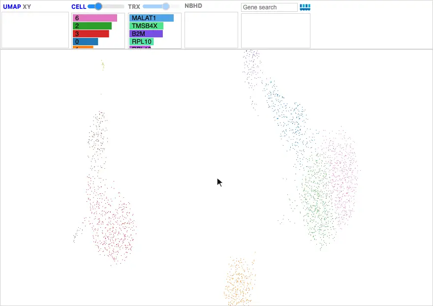

# Neighborhoods

Celldega helps you identify **neighborhoods** of cells, both in **physical
space**, such as a structure in the tissue, and in **data space**, such as an
island in a UMAP or a population in a two-gene XY plot. You can draw them in a
Landscape or create them in Python, for example with alpha shapes around a cell
type. Drawn neighborhoods keep their state: they are saved with the widget,
available in Python as a GeoDataFrame, and can be saved to a file and loaded
again.

Neighborhoods then connect to Celldega's neighborhood analysis. The
[`nbhd`](../../python/nbhd/api.md) functions summarize the cells inside each
neighborhood, such as their cell-type composition or gene expression; a
`NeighborhoodCollection` keeps the geometry and summaries together; and a
[Clustergram](../clustergram.md) compares neighborhoods by those summaries.

## Drawing a neighborhood

Create the Landscape with `nbhd_edit=True`, then:

1. Click **NBHD** to turn on editing.
2. Click **SKTCH**, or press ++s++ with the pointer over the view.
3. Drag around the cells you want; releasing the mouse closes the shape.
4. Name the neighborhood, choose a color, and click **Apply** (or press
   ++enter++).

[{ width="880" }](../../assets/img/visualizations/landscape/neighborhoods/draw_tissue.webp)

*Drawing a neighborhood around a glomerulus and naming it "glomerulus". It
appears in the NBHD bars, and its cells become the Landscape's selected cells.*

Press ++esc++ to stop sketching. While sketching, tooltips and cell clicks are
paused. New neighborhoods get unique default names, such as `nbhd_spatial_1`;
the editor checks custom names for duplicates.

## Drawing in UMAP and XY

The same tools work in a UMAP or XY view, where a neighborhood acts as a
**gate** around a population of cells. Each neighborhood belongs to the view in
which it was drawn, and only the neighborhoods of the current view are shown.
An XY neighborhood also records its genes and scale.

[{ width="880" loading=lazy }](../../assets/img/visualizations/landscape/neighborhoods/draw_umap.webp)

*Pressing S over a PBMC UMAP and drawing a gate around the monocytes.*

A gate drawn in a UMAP selects cells by their expression profile rather than
their location. With spatial data, switch to **SPATIAL** to see where those
cells are in the tissue.

## Editing neighborhoods

With editing on:

- **Click** a neighborhood to edit its shape: drag a vertex, or drag along an
  edge to add a vertex. A red **DEL** button deletes the neighborhood. Click the
  neighborhood again to finish.
- **Double-click** a neighborhood to rename it or change its color.
- **Click** a neighborhood's bar to select it and its cells.

## Viewing supplied neighborhoods

Neighborhoods made in Python, such as
[alpha shapes](../../python/nbhd/api.md) around each cell type, are passed with
`nbhd=` as a GeoDataFrame. The **NBHD** button shows or hides them, its slider
sets their opacity, and the bars list them by area; click a bar or a shape to
select it. Start in this view with `landscape_state="nbhd"`.

```python
gdf_alpha = dega.nbhd.alpha_shape_cell_clusters(adata, cat="leiden")
landscape = dega.viz.Landscape(
    base_url="https://your-landscape-files-url",
    adata=adata,
    nbhd=gdf_alpha,
    landscape_state="nbhd",
)
```

See the [alpha-shape and gradient example](../../examples/brief_notebooks/Gradient_Neighborhood_Pancreas_Islets.ipynb)
for building neighborhoods from cell types.

## Using neighborhoods in Python

As a notebook widget, a Landscape keeps every neighborhood available to Python:

- `landscape.nbhd`: a GeoDataFrame of neighborhoods from **all** views, with
  `name`, `space`, `coordinate_space`, geometry, and, for drawn neighborhoods,
  `cell_ids` and `cell_count`. `landscape.nbhd_polygons` holds the same polygons.
- `landscape.get_selected_cells(adata)`: an AnnData of the currently selected
  cells, such as those in the last drawn or selected neighborhood.
- `landscape.save_nbhds("neighborhoods.geojson")` and
  `landscape.load_nbhds("neighborhoods.geojson")` save and restore them;
  `landscape.select_nbhd("nbhd_xy_1")` selects one, restoring its view.
- Passing `nbhd=landscape.nbhd` to another Landscape of the same dataset shows
  them there too.

Spatial geometry uses the tissue's coordinates, while UMAP and XY neighborhoods
keep their display coordinates. Filter to the space you need before calculating
areas or distances, then summarize the cells inside with the `nbhd` functions:

```python
tissue_nbhds = landscape.nbhd.loc[landscape.nbhd["space"] == "spatial"]

# Cell-type composition of each drawn neighborhood.
composition = dega.nbhd.calc_nbhd_by_pop(adata, tissue_nbhds, category="cell_type")

mat = dega.clust.Matrix(composition)
mat.cluster()
dega.viz.Clustergram(matrix=mat)
```

`adata.obsm["spatial"]` must use the same coordinates as the DegaFiles. The
[Atera breast cancer neighborhoods tutorial](../../examples/tutorial_notebooks/Atera_Breast_Cancer_Neighborhood_Exploration.ipynb)
compares neighborhoods by their composition, and the
[pancreas islet gradients example](../../examples/brief_notebooks/Gradient_Neighborhood_Pancreas_Islets.ipynb)
stores geometry, summaries, and relationships in a `NeighborhoodCollection`.

??? note "How saved neighborhoods stay tied to their data"

    A fingerprint of ordered cell IDs and coordinates (or expression, for XY)
    keeps saved gates tied to their original data, even if a local server URL
    changes. UMAP and XY geometry is stored in display coordinates with Y
    increasing downward; UMAP records `axes.y.reversed=True` because increasing
    `X_umap[:, 1]` is displayed upward. Matching saved UMAP polygons from the
    previous orientation migrate automatically, and cell IDs remain unchanged.

## Source code

- [Neighborhood coordinate spaces](https://github.com/broadinstitute/celldega/blob/main/js/umap/embedding_gates.js),
  [drawing layer](https://github.com/broadinstitute/celldega/blob/main/js/deck-gl/layers/edit_layer.js),
  and [neighborhood editor](https://github.com/broadinstitute/celldega/blob/main/js/ui/nbhd_editor.js).
- [Python selection and neighborhood methods](https://github.com/broadinstitute/celldega/blob/main/src/celldega/viz/widget.py).

## Screenshot sources

Animations show the
[Atera kidney](../../examples/tutorial_notebooks/Atera_Kidney_Landscape-Clustergram.ipynb)
DegaFiles and the PBMC 3k AnnData Zarr store from the
[Chromium PBMC tutorial](../../examples/tutorial_notebooks/Scanpy_Chromium.ipynb),
captured with Celldega 0.28.0 using
[`scripts/docs_screenshots/capture.py`](https://github.com/broadinstitute/celldega/tree/main/scripts/docs_screenshots).
