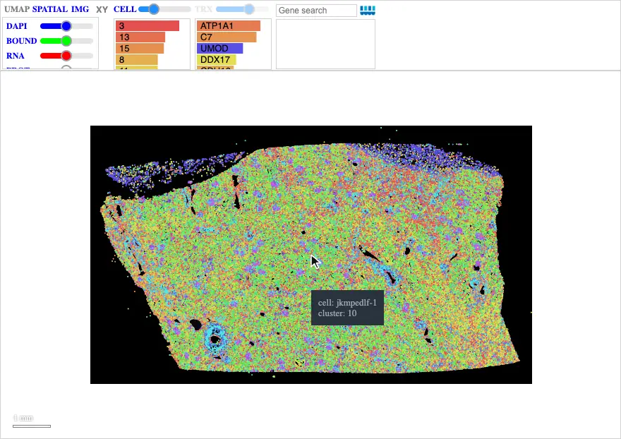
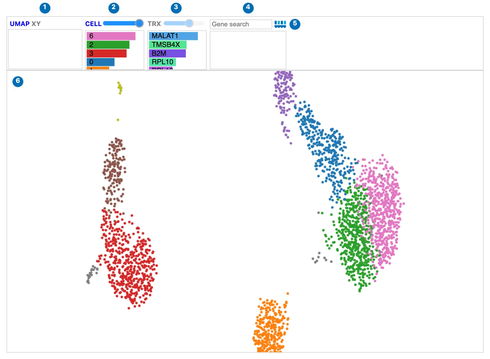
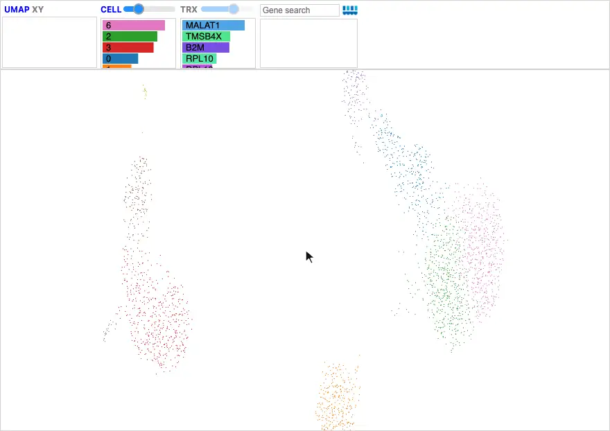
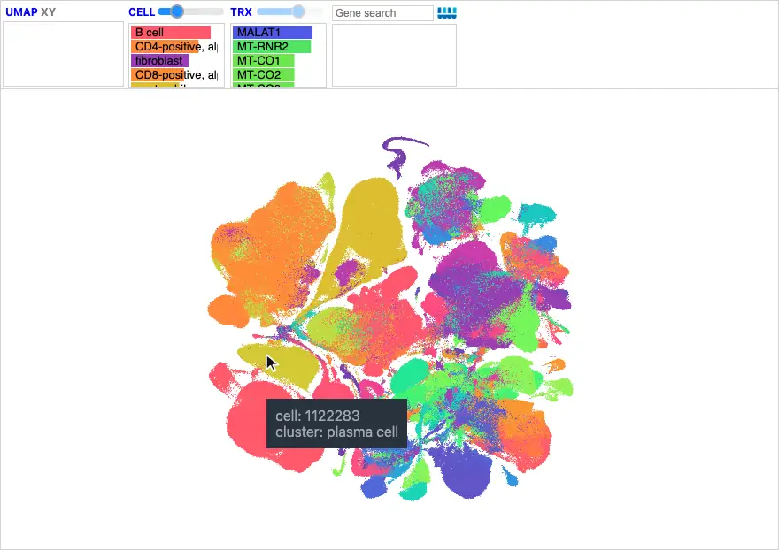

# UMAP and XY

A Landscape can show cells in a **low dimensional embedding**, such as a UMAP,
as well as in tissue. A UMAP places cells with similar expression near each
other, so islands of cells suggest cell types and states. **XY** plots each
cell's expression of two genes against each other.

For single-cell data, a linked [Clustergram](../clustergram.md) complements the
UMAP with a higher-dimensional view. The UMAP shows how cells relate to each
other; the Clustergram shows which genes distinguish them, either as cluster
signatures, such as marker-gene dot plots, or as single-cell expression across
a selected group of cells. The
[Chromium PBMC tutorial](../../examples/tutorial_notebooks/Scanpy_Chromium.ipynb)
shows both.

## Switching between tissue and UMAP

When the data include a UMAP, such as `adata.obsm["X_umap"]` passed with spatial
DegaFiles, **UMAP** and **SPATIAL** move the same cells between their embedding
and their positions in the tissue. The move is animated, so you can follow a
group of cells from one view to the other.

[{ width="880" }](../../assets/img/visualizations/landscape/umap-xy/spatial_umap.webp)

*Kidney cells move from the tissue into their UMAP and back. The image returns
when the cells are back in place.*

Cluster selections carry over between views: select a cluster in the UMAP, and
switch to **SPATIAL** to see where those cells are in the tissue. In UMAP and XY,
unselected cells are dimmed rather than hidden.

## Single-cell Landscapes from AnnData Zarr

A single-cell Landscape, without spatial data, reads an AnnData Zarr store
directly in the browser. It opens in the UMAP; there is no **SPATIAL** or **IMG**
view.

[{ width="880" loading=lazy }](../../assets/img/visualizations/landscape/umap-xy/pbmc_umap.webp)

*PBMC 3k cells in a UMAP, colored by Leiden cluster.*

| | Control | What it does |
| --- | --- | --- |
| 1 | **UMAP** · **XY** | Switch between the UMAP and the two-gene XY view. |
| 2 | **CELL** | Cell size, and the clusters of the cells in view. |
| 3 | **TRX** | The genes, and whether their values are whole-dataset or estimated for the view; see [below](#viewport-cell-types-and-estimated-expression). |
| 4 | Gene search | Color cells by one or more genes. |
| 5 | Celldega logo | Opens the Landscape documentation. |
| 6 | The view | Scroll to zoom, drag to pan, hover for details, and click to select. |

Search for a gene to color the cells by its expression:

[{ width="880" loading=lazy }](../../assets/img/visualizations/landscape/umap-xy/pbmc_gene.webp)

*Searching for LYZ highlights the monocytes; larger cells and stronger
expression opacity make the pattern easier to see.*

To prepare a store, add a CSC copy of a sparse expression layer so the browser
can read one gene at a time. The example uses raw counts:

```python
import zarr

adata.layers["counts_csc"] = adata.layers["counts"].tocsc()
adata.write_zarr("cells.zarr")
zarr.consolidate_metadata("cells.zarr")

landscape = dega.viz.Landscape(
    zarr_url="cells.zarr",
    zarr_layer="counts_csc",
    cluster_attr="cell_type",
    cell_attr=["cell_type", "sample_id"],
    nbhd_edit=True,
)
```

`zarr_url` accepts an HTTP(S) URL or a local store under the working directory,
which Python serves over HTTP. The browser loads metadata and `obsm["X_umap"]`
from the store, then reads requested genes with Zarrita. Dense or CSR expression
needs a CSC copy; `zarr_layer` selects it explicitly. An optional `adata`
supplies overriding cell metadata, cluster colors, and UMAP positions; its cell
IDs must match the store. See
[AnnData Zarr storage](../../getting-started/file_formats.md#anndata-zarr-for-a-single-cell-landscape)
for gene statistics, layer discovery, and format details.

## Viewport cell types and estimated expression

Panning or zooming in a UMAP or XY view updates the **CELL** bars with the
number of cells of each type in view, as the spatial view does when zoomed in.
Points are sized in embedding units, so they grow as you zoom in.

The gene bars follow the view too, and the **TRX** button's color shows what
they hold:

- **Blue**: every cell is in view, so the bars show whole-dataset values.
- **Purple**: zoomed in, the bars show **estimates** from cell-type signatures.
- **Gray**: zoomed in without matching signatures, so the bars keep the
  whole-dataset values.

Hover over **TRX** for an explanation of the current state. In UMAP and XY,
**TRX** is an indicator: clicking it does not load anything.

[{ width="880" loading=lazy }](../../assets/img/visualizations/landscape/umap-xy/viewport_estimates.webp)

*Zooming into the Tabula Sapiens atlas: the CELL bars count the cell types in
view, and TRX turns purple as the gene bars become signature estimates.*

### What the estimate means

For each gene, the estimate is the number of visible cells of each type times
that type's mean expression, summed and divided by the number of visible cells:

> estimated mean(gene) = Σ (visible cells of a type × the type's mean expression) / visible cells

For example, if the view holds 80 T cells with a mean of 10 for a gene and 20 B
cells with a mean of 0, the estimate is 8. If those particular T cells actually
average 20, the estimate is still 8: it captures **which cell types** are in
view, not variation **within** a type. No per-cell expression is downloaded when
the view changes. Gene coloring and XY axes always use actual cell expression.

For exact expression of every gene, or a Clustergram of the cells in view, draw
a neighborhood around them and use the matching cell-level AnnData in Python:

```python
selected = landscape.get_selected_cells(adata)
if selected.n_obs:
    mat = dega.clust.Matrix(selected)
    mat.filter("row", by="var", num=min(500, selected.n_vars))
    mat.cluster()
    cgm = dega.viz.Clustergram(matrix=mat)
```

### Providing signatures

Estimates need each cell type's mean expression, grouped the same way as the
cells being shown:

- **`adata_sig`**: an AnnData of means, sent with the widget.
- **`gene_signature_url`**: a separate signature AnnData Zarr, read by the
  browser; better for large signatures (tens of MB).
- **Spatial DegaFiles** use their own `df_sig.parquet`, each default cluster's
  mean counts per cell, **only** while the Landscape shows the DegaFiles' own
  clusters. Passing an `adata` replaces the cell metadata, so then provide
  `adata_sig` or `gene_signature_url` instead.

??? example "Prepare signatures with Scanpy"

    Give Landscape each cell type's mean expression, as an AnnData with cell
    types as `obs_names` and genes as `var_names`. Use `layers["counts"]` for
    mean raw counts per cell when the Landscape colors cells from raw counts. An
    optional `log1p` layer can hold mean log-normalized expression. For a
    cell-level AnnData with raw counts in `layers["counts"]` and log1p in `X`:

    ```python
    import scanpy as sc

    signature = sc.get.aggregate(adata, by="cell_type", func="mean", layer="counts")
    signature.layers["counts"] = signature.layers.pop("mean")
    signature.layers["log1p"] = sc.get.aggregate(adata, by="cell_type", func="mean").layers["mean"]
    signature.uns["viewport_signature"] = {
        "groupby": "cell_type",
        "layers": {"counts": "mean counts per cell", "log1p": "mean log1p counts per 10,000"},
    }

    landscape = dega.viz.Landscape(
        zarr_url="cells.zarr",
        cluster_attr="cell_type",
        adata_sig=signature,
        nbhd_edit=True,
    )
    ```

    Larger signatures are better saved as a separate AnnData Zarr:

    ```python
    import json
    import zarr

    signature.uns["viewport_signature"] = json.dumps(signature.uns["viewport_signature"])
    signature.write_zarr("cell_type_signatures.zarr")
    zarr.consolidate_metadata("cell_type_signatures.zarr")

    landscape = dega.viz.Landscape(
        zarr_url="cells.zarr",
        cluster_attr="cell_type",
        gene_signature_url="cell_type_signatures.zarr",
    )
    ```

    Means must be finite and nonnegative. Signature Zarr stores require a dense
    matrix; `adata_sig` also accepts sparse means. The estimate reads
    `viewport_signature["layer"]` when set, else `layers["counts"]`, else `X`;
    other units, such as mean log1p, also work and are named in TRX's tooltip.
    Match the layer to the expression that colors the cells. When a dataset
    mixes UMI counts with read counts (for example 10x and Smart-seq2), use
    library-size-normalized log1p expression and the signatures' `log1p` layer
    (`"layer": "log1p"`). `groupby` names the cell attribute the labels come
    from (default: `cluster_attr`). Every visible cell must have a matching
    signature; otherwise the gene bars keep the whole dataset (TRX gray) and
    TRX's tooltip reports the coverage. Up to 200 genes are shown.

## XY: two-gene expression

**XY** plots each cell's expression of two genes, with **LIN** (linear) and
**LOG** (`log1p`) axes. It is available for spatial and single-cell data with
gene expression, even without a UMAP. Type the genes in the **X** and **Y**
boxes, or select two genes before clicking **XY**. The XY view is still being
developed.

```python
landscape.set_xy("CD3D", "MS4A1", scale="log1p")
landscape.landscape_state = "spatial"  # or "umap" when available
```

UMAP's second coordinate increases upward, matching the usual AnnData and
Scanpy orientation; so does XY's Y axis.

## Widget: Python-backed interactions

- `landscape.landscape_state` reports and sets the view: `"spatial"`, `"umap"`,
  or `"xy"`.
- `landscape.xy_genes` and `landscape.xy_scale` hold the XY axes.
- Gates drawn in UMAP or XY select cells; read them with
  `landscape.get_selected_cells(adata)`. See [Neighborhoods](neighborhoods.md).

## Source code

- [UMAP/XY layouts](https://github.com/broadinstitute/celldega/blob/main/js/umap/expression_scatter.js)
  and [viewport summaries](https://github.com/broadinstitute/celldega/blob/main/js/umap/viewport_summary.js).
- [AnnData Zarr reader](https://github.com/broadinstitute/celldega/blob/main/js/read_zarr/anndata_zarr.js)
  and [signature reader](https://github.com/broadinstitute/celldega/blob/main/js/read_zarr/gene_signatures.js).

## Screenshot sources

Animations and screenshots show the
[Atera kidney](../../examples/tutorial_notebooks/Atera_Kidney_Landscape-Clustergram.ipynb)
DegaFiles with its AnnData's UMAP, the PBMC 3k AnnData Zarr store from the
[Chromium PBMC tutorial](../../examples/tutorial_notebooks/Scanpy_Chromium.ipynb),
and the [Tabula Sapiens atlas](../../gallery/gallery_tabula_sapiens.md)
(Tabula Sapiens Consortium, via CZ CELLxGENE Discover, CC BY 4.0). They were
captured with Celldega 0.28.0 using
[`scripts/docs_screenshots/capture.py`](https://github.com/broadinstitute/celldega/tree/main/scripts/docs_screenshots).
