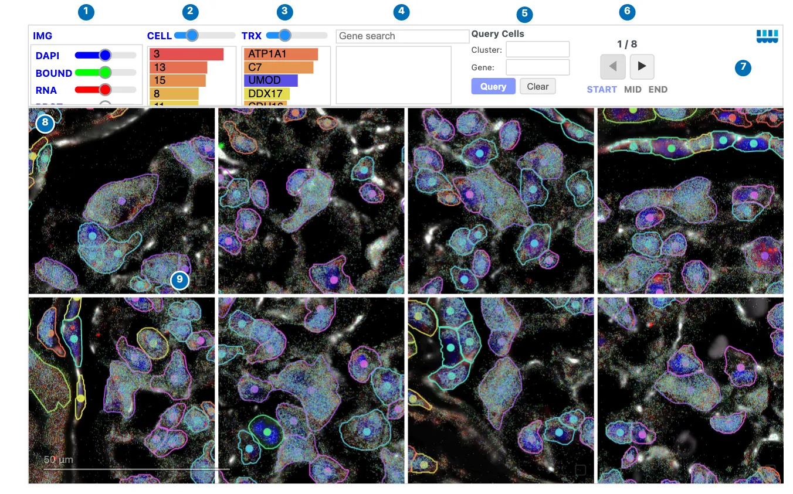
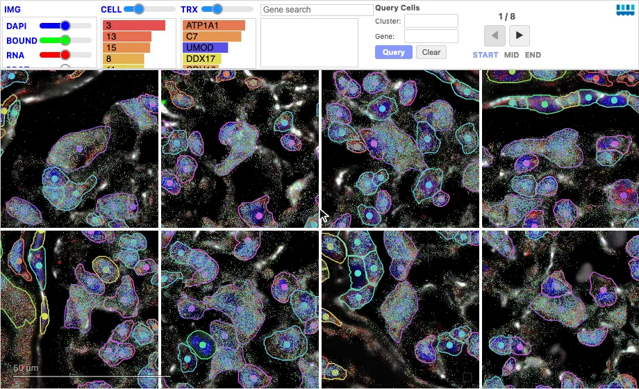

# Yearbook

`Yearbook` shows a grid of cell **portraits**: small, zoomed-in views of the
tissue, each centered on one cell. Use it to compare many individual cells side
by side, such as the cells with the highest expression of a gene or a sample of
a cluster, and to mark cells for review.

<div class="viz-preview">
  <p class="viz-preview-status" role="status">Loading an interactive preview…</p>
  <div id="preview-yearbook"></div>
</div>

*Interactive preview: kidney cells with the highest expression of the podocyte
marker NPHS2, from the same Atera kidney section. Page through the portraits,
scroll to zoom them together, or query another gene or cluster.*

## Reading a Yearbook

Each portrait shows the image, cell boundaries, and transcripts around one cell,
using the same layers and colors as a [Landscape](landscape/index.md). The
portraits share one zoom level, so cells of different sizes are compared at the
same scale.

[](../assets/img/visualizations/yearbook/overview.webp)

*Podocytes (cluster 16) ranked by their expression of NPHS2.*

| | Control | What it does |
| --- | --- | --- |
| 1 | Image | **IMG** shows or hides the image; each channel button toggles a channel, and its slider sets the channel's brightness. |
| 2 | **CELL** | Shows or hides the cells; the slider sets their size. The bars count the clusters of the cells shown; click a bar to show only that cluster's cells. |
| 3 | **TRX** | Shows or hides transcripts; the slider sets their size. Click a gene's bar, or shift-click several, to show only those genes' transcripts. |
| 4 | Gene search | Choose genes by name, as in a Landscape. |
| 5 | **Query Cells** | Find cells by cluster, gene, or both; see [Querying cells](#querying-cells). |
| 6 | Pages | Move between pages of portraits. |
| 7 | Celldega logo | Opens this page. |
| 8 | Portrait | One cell, centered. Hover a cell for its ID and cluster. |
| 9 | Review checkbox | Marks the cell for review; see [Marking cells for review](#marking-cells-for-review). |

## Zooming and panning

Scroll over any portrait to zoom **all** portraits together; each stays centered
on its own cell. Drag a portrait to look around its cell; the view re-centers
when you zoom or change pages. Double-clicking does not zoom.

## Querying cells

The **Query Cells** box finds cells in the browser, without Python:

- **Cluster only**: a random sample of that cluster's cells.
- **Gene only**: all cells, ranked by their expression of the gene, highest
  first; the portraits are colored by its expression.
- **Cluster and gene**: that cluster's cells, ranked by the gene.

Type a cluster or gene, choosing from the suggestions, and click **Query** or
press ++enter++. The status line reports how many cells were found. **Clear**
empties the boxes without changing the portraits.

[{ width="880" loading=lazy }](../assets/img/visualizations/yearbook/query_review.webp)

*Querying cluster 20, the glomerular endothelium, ranked by the endothelial
marker EMCN, finds 3,967 cells. Zooming out shows each cell's glomerulus;
checking cells on two pages and returning to the start shows that the checks
are kept.*

## Paging

The page indicator shows the current page and the total, such as `1 / 8`. Use
◀ and ▶ to move one page, or **START**, **MID**, and **END** to jump.

## Marking cells for review

Click a portrait's checkbox, at its bottom right, to mark or unmark its cell.
Checked portraits have a blue border. The checks belong to the cells, not the
page, so they are kept when you change pages or run another query. Build a
review set this way, such as possible doublets or segmentation errors, and read
it in Python.

## Widget: Python-backed interactions

As a notebook widget, a Yearbook shares its state with Python:

- **Review set**: `yb.selected_cells`, or `yb.get_selected_cells(adata)` for an
  AnnData of the checked cells. Set `yb.selected_cells = []` to clear every
  checkbox.
- **Portraits**: `yb.cells` lists the cells being shown, and `yb.front_end_query`
  the last query run in the browser.
- **Pages and zoom**: `yb.current_page`, `yb.zoom_level`, and the methods
  `next_page()`, `prev_page()`, and `go_to_page(n)`.

```python
reviewed_ids = yb.get_selected_cells()  # same IDs as yb.selected_cells
adata.obs["yearbook_review"] = adata.obs_names.isin(reviewed_ids)

# Or get a copy of the marked cells for downstream work.
reviewed = yb.get_selected_cells(adata)

# Clear every review checkbox, including those on other pages.
yb.selected_cells = []
```

A Yearbook linked to a Clustergram with
[`dega.viz.spatial_clustergram`](../python/viz/api.md), or to a Landscape with
`dega.viz.landscape_yearbook`, updates its query through Python, so these links
need a running kernel.

## Choosing which cells to show

There are three ways to choose which cells `Yearbook` displays, in increasing
order of power:

1. **An explicit id list**: `cells=["cell_1", "cell_2", ...]`.
2. **A back-end selection**: `selection=...`, accepting a
   [`celldega.select.Selection`](../python/select/api.md), a JSON-ready
   selection dict, or a plain id list. This is the recommended way to drive
   the grid from a Python `AnnData` object.
3. **A front-end query**: `front_end_query=...`, evaluated in the browser
   against the dataset's DegaFiles, needing only a `base_url` and no Python
   `AnnData`.

Use `selected_cells=` to initialize the review checkboxes. The selected list
stores original cell IDs independently of the current page and query.

## Usage

```python
import celldega as dega

yb = dega.viz.Yearbook(
    base_url="https://your-landscape-files-url",
    front_end_query={"gene": "NPHS2", "max_cells": 50},
    rows=2,
    cols=4,
)
yb
```

For constructor arguments, see the [Viz Module API reference](../python/viz/api.md).

## Examples

The [Atera kidney tutorial](../examples/tutorial_notebooks/Atera_Kidney_Landscape-Clustergram.ipynb)
includes a Yearbook for inspecting individual cells alongside a Landscape. The
[Atera kidney Yearbook review](../examples/brief_notebooks/Atera_Kidney_Yearbook_Review.ipynb)
uses `dega.select` to build a candidate queue, inspect portraits across pages,
and retrieve checked cell IDs for follow-up.

## Screenshot sources

The screenshot and animation show the
[Atera whole-transcriptome kidney DegaFiles](https://github.com/broadinstitute/Celldega_Atera_v1_WTA_Kidney_non_diseased_FFPE),
captured with Celldega 0.28.0 using
[`scripts/docs_screenshots/capture.py`](https://github.com/broadinstitute/celldega/tree/main/scripts/docs_screenshots).
